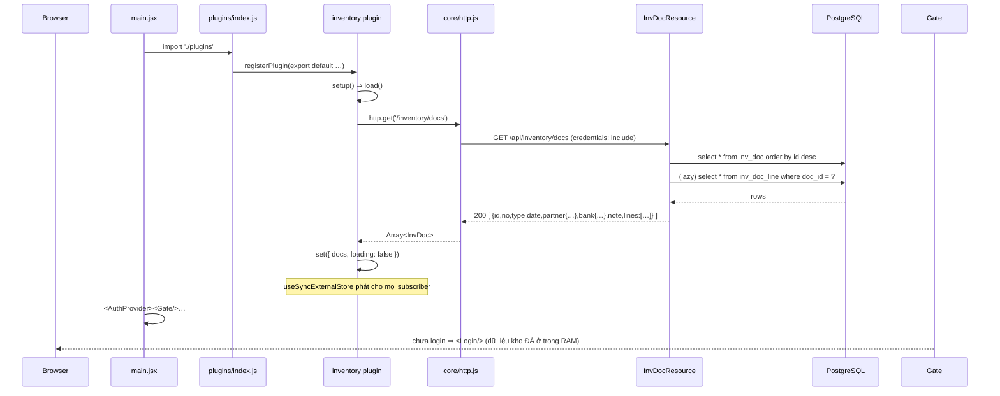
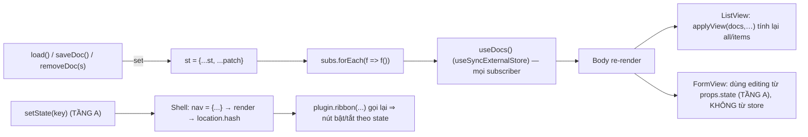

# inventory-architect.md — Phân tích KIẾN TRÚC chuyên sâu module KHO

> **Mục đích:** tài liệu "kiến trúc sư" cho module Kho — dùng khi cần **thiết kế lại / mở rộng / vá lỗi** module này mà không phải đọc lại toàn bộ mã nguồn.
> **Đối tượng:** AI agent & lập trình viên. Khác với [`inventory-agent.md`](./inventory-agent.md) (bản đồ file & checklist), tài liệu này đi sâu vào **luồng, vòng đời dữ liệu, state, validation, bảo mật và mẫu triển khai**.
> **Phạm vi mã nguồn đã phân tích:** `IvDocResource.java`, `InvDoc.java`, `InvLine.java`, `V00005__document.sql`, `plugins/inventory/index.jsx` (783 dòng), `core/{inventoryApi,http,masterdata,Autocomplete,confirm,ui,Shell,plugins,permissions,router,i18n}.js(x)`, `V00001–V00004` (đối chiếu FK).
> **Chuẩn tham chiếu:** [`PROJECT_GUIDE.md`](../../PROJECT_GUIDE.md) §2.6, §3.4, §6, §7.1; [`COMPONENT_MAPPING.md`](../../COMPONENT_MAPPING.md) §2.2, §3.4, §5.2, §6
> **Phiên bản:** `1.0.0-SNAPSHOT` · **Cập nhật:** 16/10/2026 · ⚠️ **Tài liệu này KHÔNG sửa mã nguồn** — mọi đoạn code trong tài liệu chỉ là **minh hoạ đề xuất**.
>
> 🟢 **THAY ĐỔI ĐÃ TRIỂN KHAI (16/10/2026) — đọc mục này trước, các mục dưới đây viết theo hiện trạng CŨ:**
> 1. `GET /api/inventory/docs` **đã hỗ trợ tìm kiếm/lọc/sắp xếp/phân trang ở server**: `q`, `type`, `dateFrom`, `dateTo`, `page`, `pageSize`, `sort` (whitelist `no/type/partner/date`), `dir` ⇒ trả **`{ items, total }`** (không tham số ⇒ tối đa 10.000 dòng). Tham chiếu: §5.1 (E1), §5.2 (dòng "gõ tìm kiếm"), §7.4, §10.3.
> 2. `InvDocResource` nay có **`@Authenticated`**; `DELETE` + `bulk-delete` có **`@RolesAllowed("admin")`** và chặn `ids.size() > 500` ⇒ §9.1 **S-1/S-2/S-10 đã được xử lý**.
> 3. `InvLine`/`InvDoc` **không đổi** (vẫn `long qty/price`, vẫn thay-thế-toàn-bộ-lines khi PUT) ⇒ §4, §9.1 **S-9/S-6 vẫn còn**.
> 4. FE: bỏ `applyView`/`SORT_GET` (lọc ở client) và bỏ `setup(){ load(); }`; `search()` gọi API; `inventoryApi.js` chỉ còn **một** bản ở `src/api/`; thêm key i18n `inv.loadFailed`/`inv.saveFailed`/`inv.deleteFailed`.
> 5. Còn **chưa làm** (vẫn đúng như tài liệu): validate server cho `create/update` (S-3), counter số phiếu (§10.2), DTO tách list/detail (§10.3 bước 2), `grand_total` (§10.5), audit/soft-delete (§10.10), `BigDecimal` (§10.5), cột “Tổng cộng” chưa sort được ở server.

---

## MỤC LỤC

1. [Complete flow — luồng hoàn chỉnh](#1-complete-flow--luồng-hoàn-chỉnh)
2. [Database tables — bảng dữ liệu](#2-database-tables--bảng-dữ-liệu)
3. [InvDoc lifecycle — vòng đời phiếu](#3-invdoc-lifecycle--vòng-đời-phiếu)
4. [InvLine lifecycle — vòng đời dòng hàng](#4-invline-lifecycle--vòng-đời-dòng-hàng)
5. [API usages — cách dùng API](#5-api-usages--cách-dùng-api)
6. [UI components — thành phần giao diện](#6-ui-components--thành-phần-giao-diện)
7. [State management — quản lý trạng thái](#7-state-management--quản-lý-trạng-thái)
8. [Validation rules — quy tắc kiểm tra dữ liệu](#8-validation-rules--quy-tắc-kiểm-tra-dữ-liệu)
9. [Security concerns — vấn đề bảo mật](#9-security-concerns--vấn-đề-bảo-mật)
10. [Recommended implementation patterns](#10-recommended-implementation-patterns--mẫu-triển-khai-đề-xuất)

---

## 0. BẢN ĐỒ NHANH (đọc trước 60 giây)

```
┌──────────────────────── src/main/webui/src/plugins/inventory/index.jsx ─────────────────────────┐
│  module store: st/docs  ──useDocs()──▶  Body ──▶ (mode==='form' ? FormView : ListView)          │
│        ▲                                            │                    │                     │
│        │ load/saveDoc/removeDoc/removeDocs          │ setState           │ setState            │
│        └──────────────────────────────┐             ▼                    ▼                     │
│  inventoryApi (core/) ──▶ http.js ──▶ fetch('/api/inventory/docs…', credentials:'include')      │
└────────────────────────────────────────────────────────────────────────────────────────────────┘
                                          │
┌─────────────────────────────── Quarkus :8080 ────────────────────────────────────────────────┐
│  InvDocResource  ──(Panache)──▶  InvDoc (inv_doc) ──@OneToMany cascade──▶ InvLine (inv_doc_line)│
│       │                                   ▲                                       │           │
│       │ PREFIX{import:PN, export:PX, return:PT}                                   │           │
│       └── no = PREFIX + %04d (count+1)                              line_total = qty*price     │
└──────────────────────────────────────────────┬───────────────────────────────────────────────┘
                                        PostgreSQL 15 (Flyway V00005)
```

| Thành phần | Vai trò 1 câu |
| :--- | :--- |
| `InvDocResource` | 5 endpoint, **không** tầng service, **không** annotation bảo mật |
| `InvDoc` + `InvLine` + `Ref` | 2 bảng + 1 embeddable dùng chung cho `partner`/`bank`/`product` |
| `inv_doc_counter` | Bảng đếm số phiếu an toàn — **tồn tại nhưng chưa dùng** |
| `plugins/inventory/index.jsx` | Toàn bộ UI + module store + parser CSV |
| `core/inventoryApi.js` | 6 hàm REST (⚠️ có bản sao ở `src/api/` không ai dùng) |

---

## 1. COMPLETE FLOW — LUỒNG HOÀN CHỈNH

### 1.1 Danh mục 10 luồng

| # | Luồng | Điểm vào | API | Ghi chú |
| :- | :--- | :--- | :--- | :--- |
| F1 | **Boot & nạp danh sách** | `main.jsx` → `import './plugins'` → `plugin.setup()` | `GET /api/inventory/docs` | Chạy **trước** khi render & trước đăng nhập |
| F2 | **Mở danh sách / refresh** | Bấm module trên Rail, hoặc nút ⟳ Ribbon (`plugin.refresh = load`) | `GET …/docs` | Nút ⟳ gọi lại `F1` |
| F3 | **Tìm / lọc / sắp xếp / phân trang** | Gõ ô search, chọn Menu loại phiếu, nhập khoảng ngày, bấm tiêu đề cột, đổi dòng/trang | ❌ không gọi API | Thuần client (`applyView`) |
| F4 | **Tạo phiếu** | Ribbon 📥/📤/↩️ → `FormView` → **Lưu** | `POST …/docs` | Server cấp `id` + `no` |
| F5 | **Sửa phiếu** | “✏️” trên dòng, hoặc kết quả Global Search → **Lưu** | `PUT …/docs/{id}` | Lines bị **tạo lại toàn bộ** |
| F6 | **Xoá 1 phiếu** | “🗑” trên dòng hoặc trong form | `DELETE …/docs/{id}` | CASCADE xoá lines |
| F7 | **Xoá nhiều phiếu** | Checkbox + “Xoá đã chọn” | `POST …/docs/bulk-delete` | 1 request duy nhất |
| F8 | **Import CSV** | “📂 Import” → chọn file | `POST …/docs` × N (tuần tự) + `POST /api/{suppliers\|customers\|banks\|materials}` khi cần tạo danh mục | Có thể tạo danh mục |
| F9 | **Global Search** | Ô tìm kiếm Topbar → Enter | ❌ không gọi API | Tìm trong `st.docs` |
| F10 | **In** | Ribbon tab *Trang chủ* → 🖨 | ❌ | `window.print()` dùng chung |

### 1.2 F1 — Boot & nạp danh sách (chi tiết theo thời gian)



**Điểm cần nhớ:** `setup()` được `registerPlugin` gọi **ngay khi module được import** (`core/plugins.js`: `p.setup?.({ bus })`), không chờ `Shell`. Vì `InvDocResource` **không** có `@Authenticated`, request này trả `200` kể cả khi chưa có cookie ⇒ **danh sách phiếu xuất hiện trong RAM ngay trước khi đăng nhập**.

### 1.3 F2/F3 — Đọc, tra cứu, sắp xếp (sau khi đã có `st.docs`)

```
Rail: chọn plugin 📦  ⇒ Shell đọc location.hash ⇒ active = inventory plugin
  ├─ initialState: { mode:'list', filterType:'all', editing:null, pageSize:5, selected:[], importing:false, …EMPTY_VIEW }
  └─ <active.View {...props} />   props = { state, setState, can, role, bus }
       View: can('inventory','read') ? <Body/> : <Denied/>
         Body: useDocs() ⇒ { docs, loading, error }
           loading && !docs.length ? <Loading/>
           state.mode === 'form' && state.editing ? <FormView/> : <ListView docs={docs}/>
             ListView:
               all   = applyView(docs, {filterType, q, filters, sort})   ← LỌC CLIENT (3 tiêu chí + sort)
               total = all.length ; totalPages = ceil(total/pageSize)
               page  = clamp(state.page, 1, totalPages)
               items = all.slice((page-1)*pageSize, page*pageSize)
```
Không có request nào được gửi trong F3 ⇒ đổi bộ lọc/trang **chỉ** ghi `location.hash` (`setState(..., {replace:true})`) và render lại.

### 1.4 F4/F5 — Lưu phiếu (luồng ghi quan trọng nhất)

```mermaid
sequenceDiagram
    participant U as Người dùng
    participant F as FormView
    participant S as saveDoc()
    participant A as inventoryApi
    participant R as InvDocResource
    participant DB as PostgreSQL

    U->>F: Sửa master (Autocomplete partner/bank, date, note)
    U->>F: Thêm dòng (Autocomplete product ⇒ tự điền price), qty, price
    U->>F: Kéo thả / ▲▼ / xoá dòng
    U->>F: Bấm "Lưu phiếu"
    F->>F: validate: partner? lines.length? mọi dòng product.id && qty>0?
    alt Không hợp lệ
        F-->>U: alert(inv.validate) (dừng)
    else Hợp lệ
        F->>S: saveDoc(editing)
        S->>S: chuẩn hoá payload (partner/bank ⇒ {id,name}; lines[].id ⇒ null nếu là id tạm)
        alt payload.id (đang sửa)
            S->>A: update(id, payload)
            A->>R: PUT /api/inventory/docs/{id}
            R->>DB: select inv_doc by id (404 nếu không có)
            R->>DB: update master; DELETE all inv_doc_line; INSERT lines mới (pos 0..n-1)
            R-->>S: 200 InvDoc (lines id mới)
            S->>S: thay doc trong st.docs
        else chưa có id (tạo mới)
            S->>A: create(payload)
            A->>R: POST /api/inventory/docs
            R->>DB: count(*) where type=:type  ⇒ n = count+1
            R->>DB: INSERT inv_doc(no=PREFIX+%04d) + INSERT lines (cascade)
            R-->>S: 201 InvDoc
            S->>S: chèn doc lên đầu st.docs
        end
        S-->>F: doc
        F->>F: setState({ mode:'list', editing:null [, …EMPTY_VIEW nếu là phiếu mới] })
        F-->>U: về danh sách (phiếu mới hiện ở đầu vì list sắp id DESC)
    end
```

### 1.5 F6/F7 — Xoá phiếu

```
F6  “🗑” trong danh sách (ListView.onDelete)  |  “🗑 Xóa phiếu” trong form (FormView.doDelete)
      ⇒ await confirm(t('inv.confirmDelete').replace('{name}', doc.no))   [modal core/confirm.jsx]
      ⇒ removeDoc(id)  ⇒ DELETE /api/inventory/docs/{id}  ⇒ 204 void
      ⇒ set({ docs: st.docs.filter(d => d.id !== id) })
      ⇒ ListView ở lại trang hiện tại; nếu trang trống thì `page = clamp(...)` tự lùi

F7  Checkbox (HeaderCheck "chọn tất cả trên trang") + nút "Chọn tất cả {n} phiếu" (chỉ khi đã chọn hết trang)
      selected = all.filter(d => selSet.has(d.id))       ← chỉ tính phiếu ĐANG KHỚP BỘ LỌC (an toàn)
      ⇒ confirm(inv.confirmBulkDelete với {n})
      ⇒ removeDocs(ids)  ⇒ POST /api/inventory/docs/bulk-delete  body [1,2,3]  ⇒ 204
      ⇒ setSel([]) + xoá khỏi store
      ⚠️ Lỗi ⇒ alert(...) và các id ĐÃ xoá thành công vẫn còn trong store (không có cơ chế đối账 lại)
```

### 1.6 F8 — Import CSV (luồng phức tạp nhất)

```
“📂 Import” (ListView) ⇒ importbox ⇒ <input type=file accept=".csv,text/csv">
onFile:  const text = await file.text()
  └─ importDocs(text, { can, t })
       1) parseCsv(text)
            - bỏ BOM, tự chọn dấu phân cách: header có nhiều ';' hơn ',' ⇒ ';' (Excel VN)
            - hỗ trợ escape "" trong ô có ngoặc kép
       2) header = rows[0].map(norm) ; IMPORT_COLS = [ref,type,partner,date,note,bank,product,qty,price]
          thiếu 1 trong IMPORT_REQUIRED [type,partner,product,qty] ⇒ dừng, trả { ok:0, errors:[errHeader] }
       3) gom nhóm theo cột `ref` (ref rỗng ⇒ mỗi dòng 1 phiếu); master lấy ở DÒNG ĐẦU của nhóm
       4) với mỗi nhóm:
            - validate type ∈ PREFIX ; partner không rỗng ; parseDate(date)
            - validate TẤT CẢ dòng hàng TRƯỚC (product, qty>0, price≥0) ⇒ lỗi thì bỏ cả phiếu
              (mục đích: không tạo danh mục mồ côi)
            - resolve đối tác:  import ⇒ suppliersStore | export/return ⇒ customersStore
            - resolve ngân hàng (nếu có), resolve từng sản phẩm (fill price từ danh mục nếu CSV trống)
                resolve(): cache theo `kind|norm(name)` → searchXxx(name) khớp norm ⇒ dùng
                           chưa có && can('catalog','create') ⇒ store.add({name}) ⇒ dùng bản ghi mới
                           chưa có && KHÔNG có quyền ⇒ null ⇒ lỗi "Không tìm thấy ... trong Danh mục"
            - await saveDoc({ type, partner, bank, date, note, lines })   ← POST tuần tự
              thành công ⇒ ok++ ; lỗi ⇒ errors.push('Dòng {line}: {msg}')
       5) trả { ok, errors[] }
  ⇒ setImp({ busy:false, result, key: key+1 })   ← tăng key để chọn lại cùng file vẫn chạy
  ⇒ nếu ok>0: setState({ filterType:'all', ...EMPTY_VIEW }) ⇒ thấy phiếu mới ở đầu
```

### 1.7 F9/F10 — Global Search & In

```
F9  Topbar input → Enter → Shell: setNav(n => ({...n, found: query.trim()}))
      GlobalSearch.render: searchable = plugins.filter(p => p.search && can(p.id,'read'))
        <Group plugin={inventory}> → useApi(() => plugin.search(query), [query])
          inventory.search(q): lọc st.docs theo `no + partner.name` (lowercase) ⇒
            [{ id, title: d.no, subtitle: d.partner?.name ?? d.type, state:{ mode:'form', editing: d } }]
        bấm kết quả ⇒ Shell.openResult(p, r) ⇒ merge r.state vào store[p.id] ⇒ FormView với editing = doc đó

F10 Ribbon commonTabs: { id:'print', icon:'🖨', onClick: () => window.print() }
      ⇒ in đúng những gì đang hiển thị (không có @media print riêng cho phiếu)
```

### 1.8 Trace một vòng đầy đủ (byte → DB), ví dụ "tạo phiếu nhập"

```
[UI]      FormView.doSave()                            plugins/inventory/index.jsx:652
[FE svc]  saveDoc(editing)                             :36
[FE api]  inventoryApi.create(payload)                 core/inventoryApi.js:6
[FE api]  http.post('/inventory/docs', payload)        core/http.js:51 → request():26
[HTTP]    POST /api/inventory/docs  Cookie: token=…    credentials:'include'
[BE]      InvDocResource.create(InvDoc d)              @Transactional
            d.id = null ; d.lines.forEach(l → l.id = null)
            long n = InvDoc.count("type", d.type) + 1
            d.no = PREFIX.get(d.type) + String.format("%04d", n)
            d.persist()                                 (cascade ALL + orphanRemoval)
[JPA]     INSERT INTO inv_doc (no,type,partner_id,partner_name,bank_id,bank_name,doc_date,note) VALUES (…)
          INSERT INTO inv_doc_line (doc_id,pos,product_id,product_name,qty,price) VALUES (…,…)
[DB]      line_total = qty*price (generated) ; UNIQUE(no) ; UNIQUE(doc_id,pos) ; CHECK(qty>0)
[HTTP]    201 Created + JSON InvDoc (id, no, lines[].id)
[FE]      store: set({ docs: [created, ...st.docs] })
[UI]      setState({ mode:'list', editing:null, filterType:'all', ...EMPTY_VIEW })
```

**Biến thể khi lỗi:**
| Tình huống | Kết quả hiện tại |
| :--- | :--- |
| Không có cookie JWT | ✅ vẫn thành công (endpoint không bảo vệ) |
| `partner = null` | `500` (vi phạm `partner_name NOT NULL`) ⇒ FE chỉ hiện `alert("inv.saveFailed: …")` |
| `type` không hợp lệ | `500` (vi phạm CHECK) |
| `qty = 0` | `500` (vi phạm CHECK) |
| 2 request tạo cùng loại đồng thời | Request thứ hai có thể nhận `500` do `UNIQUE(no)` |
| `PUT` id không tồn tại | `404` |
| Mất mạng | `HttpError(0, 'Không kết nối được máy chủ')` ⇒ `alert(...)` |

---

## 2. DATABASE TABLES — BẢNG DỮ LIỆU

### 2.1 Sơ đồ quan hệ

```
   ┌──────────────────────┐            ┌────────────────────────────┐
   │ material_types       │            │ suppliers / customers      │
   │ id varchar(36) PK    │            │ id varchar(36) PK          │
   └───────▲──────────────┘            └────────────────────────────┘
           │ FK RESTRICT                        ⚠️ KHÔNG FK (partner trỏ 2 bảng)
   ┌───────┴──────────┐                          │  (chỉ lưu snapshot id+name)
   │ materials        │                          │
   │ id varchar(36) PK│                          │
   └───────▲──────────┘                          │
           │ FK (product_id, NOT NULL)           │
   ┌───────┴───────────────────┐   ┌──────────────┴───────┐        ┌────────────────┐
   │ inv_doc_line              │   │ inv_doc              │        │ banks          │
   │ id bigserial PK           │◀──│ id bigserial PK      │        │ id varchar(36) │
   │ doc_id bigint FK CASCADE ─┘   │ no varchar(20) UNIQ  │        └────────▲───────┘
   │ pos int + UNIQUE(doc_id,pos)  │ type varchar(10) CHK │                 │ FK SET NULL
   │ product_id / product_name     │ partner_* NOT NULL ──┴────────────────►│ bank_*
   │ qty numeric(18,3) / price     │ doc_date NOT NULL DEFAULT now
   │ line_total GENERATED STORED   │ note, created_*, updated_*
   └───────────────────────────────┘
                │
                │ (đếm số phiếu — CÓ SẴN NHƯNG CHƯA DÙNG)
   ┌────────────┴──────────────┐
   │ inv_doc_counter           │  type PK ('import','export','return') · last_no bigint
   └───────────────────────────┘
```

### 2.2 `inv_doc` (master phiếu) — DDL hiện tại

```sql
CREATE TABLE inv_doc (
    id            bigserial PRIMARY KEY,
    no            varchar(20)  NOT NULL UNIQUE,                    -- PN0001 / PX0001 / PT0001
    type          varchar(10)  NOT NULL CHECK (type IN ('import','export','return')),
    partner_id    varchar(36)  NOT NULL,                           -- cố ý KHÔNG FK (trỏ suppliers|customers)
    partner_name  varchar(255) NOT NULL,                           -- snapshot
    bank_id       varchar(36)  REFERENCES banks(id) ON DELETE SET NULL,
    bank_name     varchar(255),                                    -- snapshot
    doc_date      date         NOT NULL DEFAULT CURRENT_DATE,
    note          varchar(1000),
    created_at    timestamptz  NOT NULL DEFAULT now(),
    created_by    varchar(100),
    updated_at    timestamptz  NOT NULL DEFAULT now(),
    updated_by    varchar(100)
);
CREATE INDEX idx_inv_doc_type_date ON inv_doc (type, doc_date DESC);
CREATE INDEX idx_inv_doc_date      ON inv_doc (doc_date);
CREATE INDEX idx_inv_doc_partner   ON inv_doc (partner_id);
```

| Entity field (`InvDoc.java`) | Cột DB | Kiểu Java ↔ DB | Ghi chú |
| :--- | :--- | :--- | :--- |
| `id` | `id` | `Long` ↔ `bigserial` | `@Id @GeneratedValue(IDENTITY)` |
| `no` | `no` | `String` ↔ `varchar(20)` | Server sinh; **UNIQUE** là chốt chống trùng |
| `type` | `type` | `String` ↔ `varchar(10)` | `import`/`export`/`return` (CHECK) |
| `date` | `doc_date` | `LocalDate` ↔ `date` | `@Column(name="doc_date")`; FE gửi `yyyy-MM-dd` |
| `partner` (`Ref`) | `partner_id`, `partner_name` | `String`×2 ↔ `varchar(36)`,`varchar(255)` | `@Embedded @AttributeOverrides`; **NOT NULL** |
| `bank` (`Ref`) | `bank_id`, `bank_name` | `String`×2 ↔ `varchar(36)`,`varchar(255)` | nullable; FK SET NULL |
| `note` | `note` | `String` ↔ `varchar(1000)` | Không validate độ dài ⇒ > 1000 ký tự = 500 |
| `lines` | *(bảng con)* | `List<InvLine>` | `cascade=ALL, orphanRemoval=true` + `@JoinColumn("doc_id")` + `@OrderColumn("pos")` |
| — | `created_*` / `updated_*` | — | **Không có field trong entity** ⇒ không bao giờ được ghi/đọc (`created_at`/`updated_at` chỉ nhờ DEFAULT) |

### 2.3 `inv_doc_line` (detail) — DDL hiện tại

```sql
CREATE TABLE inv_doc_line (
    id            bigserial PRIMARY KEY,
    doc_id        bigint       NOT NULL REFERENCES inv_doc(id) ON DELETE CASCADE,
    pos           int          NOT NULL,                       -- thứ tự kéo thả (0..n-1)
    product_id    varchar(36)  NOT NULL REFERENCES materials(id),
    product_name  varchar(255) NOT NULL,                       -- snapshot
    qty           numeric(18,3) NOT NULL CHECK (qty > 0),
    price         numeric(18,2) NOT NULL DEFAULT 0 CHECK (price >= 0),
    line_total    numeric(20,2) GENERATED ALWAYS AS (qty * price) STORED,
    UNIQUE (doc_id, pos)
);
CREATE INDEX idx_inv_doc_line_doc     ON inv_doc_line (doc_id);
CREATE INDEX idx_inv_doc_line_product ON inv_doc_line (product_id);
```

| Entity field (`InvLine.java`) | Cột DB | Kiểu Java ↔ DB | Ghi chú |
| :--- | :--- | :--- | :--- |
| `id` | `id` | `Long` ↔ `bigserial` | |
| `product` (`Ref`) | `product_id`, `product_name` | `String`×2 ↔ `varchar(36)`,`varchar(255)` | FK NOT NULL tới `materials` |
| `qty` | `qty` | ⚠️ `long` ↔ `numeric(18,3)` | **Lệch kiểu** — không biểu diễn được phần thập phân (vd. 0,5 kg) |
| `price` | `price` | ⚠️ `long` ↔ `numeric(18,2)` | **Lệch kiểu** |
| `lineTotal` | `line_total` | `BigDecimal` ↔ `numeric(20,2)` | `insertable=false, updatable=false` (cột generated) |
| *(không có field)* | `pos` | — | Hibernate quản lý qua `@OrderColumn("pos")` trên `InvDoc.lines` |

### 2.4 `inv_doc_counter` (có sẵn nhưng **chưa dùng**)

```sql
CREATE TABLE inv_doc_counter (
    type    varchar(10) PRIMARY KEY CHECK (type IN ('import','export','return')),
    last_no bigint NOT NULL DEFAULT 0
);
INSERT INTO inv_doc_counter (type) VALUES ('import'), ('export'), ('return');
```
`V00005` kèm sẵn chú thích cách dùng an toàn (`UPDATE … RETURNING last_no`), nhưng `InvDocResource.create()` vẫn dùng `InvDoc.count("type", d.type) + 1` ⇒ bảng này hiện chỉ chiếm chỗ. Xem §10.2.

### 2.5 Vì sao `partner` không có FK

Phiếu nhập trỏ `suppliers`, phiếu xuất/trả trỏ `customers` — **hai bảng khác nhau** ⇒ không thể đặt FK đơn. Giải pháp đang dùng: lưu **`id` + `name` snapshot** trong `Ref`.
- ✅ Ưu: đổi tên/xoá NCC không làm sai chứng từ cũ; không cần bảng `parties` hợp nhất.
- ⚠️ Nhược: `partner_id` không có toàn vẹn tham chiếu (có thể trỏ tới id đã xoá); truy vết phải dựa vào `partner_name`.

### 2.6 Ma trận ràng buộc DB (quyết định hành vi khi dữ liệu sai)

| Ràng buộc | Vi phạm khi | Hiện trả về | Nên trả về |
| :--- | :--- | :--- | :--- |
| `inv_doc.no UNIQUE` | 2 phiếu cùng số (đồng thời / count sai) | `500` | `409` + retry sinh số |
| `CHECK type IN (…)` | Gửi `type` lạ | `500` | `400 {"message":"Loại phiếu không hợp lệ"}` |
| `partner_name NOT NULL` | `partner = null` | `500` | `400` |
| `partner_id NOT NULL` | `partner = {name:'x'}` thiếu id | `500` | `400` |
| `bank_id FK → banks` | `bank.id` không tồn tại | `500` | `400`/`409` |
| `inv_doc_line.product_id FK → materials NOT NULL` | thiếu/không tồn tại sản phẩm | `500` | `400` |
| `CHECK qty > 0` / `price >= 0` | qty 0 hoặc âm | `500` | `400` |
| `UNIQUE(doc_id,pos)` | trùng `pos` khi ghi dòng (hiếm, do Hibernate quản lý) | `500` | `409` |
| `doc_id FK ON DELETE CASCADE` | xoá phiếu | ✅ tự xoá dòng | — |
| `note varchar(1000)` | ghi chú quá dài | `500` | `400` |
| `line_total GENERATED` | client gửi `lineTotal` | bị bỏ qua (`insertable=false`) | — |

---

## 3. InvDoc LIFECYCLE — VÒNG ĐỜI PHIẾU

### 3.1 Trạng thái (không có cột `status` — đây là điểm quan trọng)

Module hiện **không có trạng thái nghiệp vụ** (nháp / đã duyệt / đã ghi sổ). Vòng đời chỉ gồm **sự tồn tại của bản ghi**:

```
        (chưa tồn tại)
              │  Ribbon ➕ / 📥 / 📤 / ↩️
              ▼
   ┌────────────────────────┐   "Lưu"   ┌──────────────────────┐
   │  DRAFT trong UI        │──────────▶│  PERSISTED trong DB  │
   │  blankDoc(type)        │  POST     │  id + no được cấp    │
   │  sống trong location.hash          └──────────┬───────────┘
   └────────────────────────┘                      │  "✏️ Lưu" ⇒ PUT (no/type bất biến)
              ▲                                    │
              │ đóng form (không lưu)              ▼
              └──────────── "🗑" ⇒ DELETE ⇒ CASCADE xoá hết dòng ⇒ (không còn tồn tại)
```

| Khái niệm | Hiện trạng |
| :--- | :--- |
| "Draft" | Chỉ tồn tại trong `location.hash` (`state.store.inventory.editing`). **Không** có bản ghi nháp ở DB |
| "Đã ghi sổ / khoá phiếu" | ❌ Không có |
| "Đã duyệt" | ❌ Không có |
| "Đã xoá" | Xoá cứng; không có soft-delete, không có thùng rác |
| Ai tạo/sửa | Cột `created_by`/`updated_by` **có trong DB nhưng không bao giờ được ghi** |

### 3.2 Bảng chuyển trạng thái

| Hành động | Điểm vào (FE) | API | Tác động DB | `id` / `no` |
| :--- | :--- | :--- | :--- | :--- |
| Mở form tạo mới | `ribbon` → `setState({mode:'form', editing: blankDoc(type)})` | — | — | chưa có |
| Mở form sửa | `ListView` “✏️” hoặc Global Search | — | — | có sẵn |
| Thêm dòng hàng | `FormView.addLine()` (`:626`) | — | — | line id tạm |
| Lưu (tạo) | `doSave()` (`:652`) → `saveDoc()` | `POST /docs` | `INSERT inv_doc` + `INSERT inv_doc_line × n` | server cấp `id` (IDENTITY) và `no` = `PREFIX+%04d` |
| Lưu (sửa) | `doSave()` | `PUT /docs/{id}` | `UPDATE inv_doc` (chỉ `partner/bank/date/note`) + `DELETE inv_doc_line WHERE doc_id` + `INSERT × n` | `id`, `no`, `type` **giữ nguyên** |
| Xoá | `onDelete()` (`:455`), `doDelete()` (`:669`) | `DELETE /docs/{id}` | `DELETE inv_doc` ⇒ CASCADE `inv_doc_line` | bản ghi biến mất |
| Xoá nhiều | `onBulkDelete()` (`:477`) | `POST /docs/bulk-delete` | `delete("id in ?1", ids)` + CASCADE | — |
| Tải lại | `load()` / `refresh` | `GET /docs` | `select … order by id desc` | — |

### 3.3 Quy tắc cấp `id` và `no` (chi tiết quyết định tính đúng đắn)

**`id`**
- Do `@Id @GeneratedValue(strategy = IDENTITY)` cấp từ `bigserial` ⇒ FE **luôn** gửi `id: null` khi tạo (`create()` cũng cưỡng chế `d.id = null`).
- Khi sửa, `id` lấy từ **path** (`PUT /docs/{id}`) — body `id` **không** được dùng.

**`no` (số phiếu)**
```
n    = InvDoc.count("type", d.type) + 1        ← đếm ALL phiếu cùng loại rồi +1
no   = PREFIX[type] + String.format("%04d", n) // PN0001, PX0001, PT0001
```
Hệ quả cần biết (đã ghi trong chính comment của code):
1. **Không an toàn khi đồng thời:** 2 request cùng `type` có thể tính ra cùng `n` ⇒ `UNIQUE(no)` ⇒ một request `500`.
2. **Số phiếu bị "tái sử dụng" sau khi xoá:** xoá phiếu cuối (PN0007) ⇒ phiếu tạo tiếp theo cũng là `PN0007` (vì count giảm). Với chứng từ kế toán, điều này thường **không mong muốn** (trùng số với chứng từ đã in/huỷ).
3. **`inv_doc_counter` đã có sẵn** để khắc phục cả (1) và (2) nhưng chưa được dùng.
4. `PREFIX` bị **khai báo 2 nơi**: `InvDocResource.PREFIX` (server, nguồn sự thật) và `PREFIX` (FE, dùng để hiển thị/nhóm) — thêm loại phiếu phải sửa cả hai.

### 3.4 Điều gì **không đổi được** sau khi tạo (điểm tốt cần giữ)

`InvDocResource.update()` chỉ sao chép 4 trường:
```java
d.partner = in.partner; d.bank = in.bank; d.date = in.date; d.note = in.note;
```
⇒ `type`, `no`, `id` **bất biến** ở server dù client có gửi. FE cũng đã `disabled={!isNew}` cho `<select type>`. **Giữ nguyên hành vi này** khi refactor (đổi loại phiếu ⇒ phải tạo phiếu mới).

### 3.5 Ảnh hưởng của phiếu tới module khác

| Sự kiện | Ảnh hưởng |
| :--- | :--- |
| Tạo phiếu có `bank` mới | `banksStore.add()` ⇒ bản ghi mới trong `banks` (nếu user có `catalog.create`) |
| Tạo phiếu có `product` mới | `materialsStore.add({name, unit:'cái', price:0, typeId:null})` ⇒ vật tư "thô" chưa có loại/giá |
| Xoá `banks`/`materials` đang dùng | ❌ bị chặn: `bank_id` FK SET NULL (cho phép xoá ngân hàng → phiếu mất `bank_id` nhưng giữ `bank_name`), `product_id` FK RESTRICT (**không** xoá được vật tư) |
| Xoá phiếu | Không ảnh hưởng danh mục (chỉ xoá dòng của phiếu) |
| Chưa có tổng hợp tồn kho | Phiếu **không** được cộng/trừ vào bất kỳ bảng tồn kho nào — hiện là chứng từ thuần |

---

## 4. InvLine LIFECYCLE — VÒNG ĐỜI DÒNG HÀNG

### 4.1 Danh tính dòng: "id tạm" → "id thật" (điểm dễ vỡ nhất)

```
FE thêm dòng:        id = Date.now() + Math.random()        (:626)   ← số thực rất lớn (~1.7e12)
FE import CSV:       id = nextId() = ++idSeq  (idSeq = Date.now())   (:22-23)
                      │
                      ├─ dùng làm `key={l.id}` trong React và khoá so khớp khi update/remove
                      ▼
FE lưu (saveDoc):    id: typeof l.id === 'number' && l.id < 100000000 ? l.id : null   (:43)
                      │        ▲
                      │        └─ HEURISTIC: "id nhỏ = id thật từ DB", "id lớn = id tạm"
                      ▼
BE lưu (POST/PUT):   create(): d.lines.forEach(l -> l.id = null)   ← xoá hết id, luôn INSERT mới
                     update(): d.lines.clear(); in.lines.forEach(l -> { l.id = null; d.lines.add(l); })
                      ▼
DB:                  INSERT inv_doc_line (id từ bigserial, pos = 0..n-1)
FE nhận lại:         doc.lines có id THẬT (gán vào st.docs)
```

| Đánh giá | Nội dung |
| :--- | :--- |
| ✅ Ưu | Không cần API riêng cho từng dòng; toàn bộ phiếu là 1 payload → 1 transaction |
| ⚠️ Nguy cơ 1 | Heuristic `id < 100000000` vỡ khi: DB vượt 100 triệu dòng hàng (unlikely nhưng silent), hoặc id tạm đổi cách sinh, hoặc seed dữ liệu với id nhỏ tuỳ ý |
| ⚠️ Nguy cơ 2 | `Date.now() + Math.random()` là số **thực** (float) — không dùng làm khoá DB được, và nếu code khác giả định `Number.isInteger` sẽ sai |
| ⚠️ Nguy cơ 3 | `idSeq` là biến module-level ⇒ tăng đơn điệu trong phiên; **có thể** sinh id tạm nhỏ nếu `Date.now()` bị mock trong test |

### 4.2 Thao tác trên dòng (tất cả đều **chỉ sửa state**, không gọi API)

| Thao tác | Hàm | Dòng code | Logic |
| :--- | :--- | :--- | :--- |
| Thêm dòng | `addLine()` | `:626` | append `{ id: Date.now()+Math.random(), product:null, qty:1, price:0 }` |
| Sửa dòng | `updateLine(id, patch)` | `:625` | map theo `l.id === id` để merge patch |
| Chọn sản phẩm | `Autocomplete onChange` | `:734` | `updateLine(l.id, { product: p, price: p?.price ?? l.price })` ← tự điền đơn giá từ danh mục |
| Xoá dòng | `removeLine(l)` | `:629` | nếu `isLineEmpty(l) = !l.product && !l.price` ⇒ xoá ngay; ngược lại hỏi `inv.confirmDeleteLine` |
| Đổi thứ tự (▲▼) | `moveLine(from,to)` | `:641` | `splice` trong mảng ⇒ vị trí mảng = `pos` |
| Đổi thứ tự (drag) | `onDragStart/onDragOver/onDrop` | `:721-732` | ghi `drag` state để vẽ `dropbefore/dropafter`, thả ⇒ `moveLine(drag.from, i)` |
| Tính thành tiền dòng | inline | `:738` | `vnd(l.qty * l.price)` |
| Tính tổng phiếu | `lineTotal(lines)` | `:13` | `reduce((s,l) => s + qty*price)` — hiển thị ở `<tfoot>` |

### 4.3 Vòng đời `pos` (thứ tự dòng)

```
FE: mảng editing.lines          [A, B, C]        ← thứ tự tương tác
      ⇅ moveLine / drag
BE: @OrderColumn(name="pos")    A→0, B→1, C→2    ← Hibernate ghi pos theo CHỈ SỐ MẢNG
DB: UNIQUE(doc_id, pos)         0,1,2            ← chốt chặn trùng thứ tự
```
- `pos` **không** có field trong `InvLine` — muốn đọc `pos` phải join qua `@OrderColumn` hoặc query native.
- Vì `PUT` **xoá tất cả rồi chèn lại**, `pos` luôn được tái tạo `0..n-1` ⇒ không bao giờ "lỗ hổng" vị trí.
- ⚠️ Nếu chuyển sang cập nhật kiểu **merge** (giữ id cũ), phải xử lý `UNIQUE(doc_id,pos)` khi hoán vị (Postgres kiểm tra **từng dòng**, nên đổi chỗ 2 dòng có thể vi phạm tạm thời). Cách an toàn: cập nhật `pos` theo 2 lượt hoặc dùng `DEFERRABLE` constraint (cần migration).

### 4.4 Con đường ghi xuống DB (quan sát từ entity ↔ DDL)

**POST (tạo mới):** 1 `INSERT inv_doc` + n `INSERT inv_doc_line` (cascade), `pos = 0..n-1`, `line_total` do DB tính.
**PUT (sửa):** 1 `SELECT inv_doc` → 1 `UPDATE inv_doc` (4 cột master) → 1 `DELETE FROM inv_doc_line WHERE doc_id = ?` → n `INSERT inv_doc_line`.
⇒ Mỗi lần "Lưu" khi sửa: **toàn bộ dòng đổi id**, sequence `inv_doc_line_id_seq` tăng n, và số dòng bị churn theo số lần lưu (không phải số dòng thay đổi).

### 4.5 Tiền & số: nơi phát sinh sai số

| Nơi tính | Công thức | Kiểu | Ghi chú |
| :--- | :--- | :--- | :--- |
| FE — thành tiền dòng | `l.qty * l.price` | JS `number` | Chỉ để hiển thị (`vnd`) |
| FE — tổng phiếu | `lineTotal(lines)` | JS `number` | Hiển thị `<tfoot>`; **không** gửi lên server |
| DB — thành tiền dòng | `qty * price` | `numeric(20,2) GENERATED` | Nguồn sự thật; client gửi `lineTotal` sẽ bị **bỏ qua** |
| Entity | `long qty`, `long price`, `BigDecimal lineTotal` | ⚠️ lệch | Vì Java dùng `long`, phần thập phân của `numeric(18,3)` **không thể** được tạo ra từ API (nhưng có thể tồn tại nếu insert trực tiếp bằng SQL) ⇒ đọc lên có thể lỗi/mất mát |

### 4.6 Ví dụ vòng đời một dòng (sửa 1 lần)

```
#1 Add dòng:            { id: 1.755e12, product: {id:'vt-1',name:'Bàn phím',price:700000}, qty: 10, price: 700000 }
#2 Lưu (POST) → DB:      INSERT ... VALUES (doc_id=1, pos=0, product_id='vt-1', qty=10, price=700000) ⇒ id = 41
#3 FE nhận doc.lines:   [ { id: 41, product:{…}, qty:10, price:700000, lineTotal: 7000000 } ]
#4 Đổi qty = 12 ⇒ Lưu (PUT):
     DELETE FROM inv_doc_line WHERE doc_id = 1      ← id 41 BIẾN MẤT
     INSERT ... (doc_id=1, pos=0, qty=12, …)        ⇒ id = 42   ← id mới
#5 Undo? Không có. Audit? Không có. (Đây là lý do nên cân nhắc merge-theo-id hoặc soft-delete dòng)
```

---

## 5. API USAGES — CÁCH DÙNG API

### 5.1 Bề mặt API (6 endpoint)

| # | Method + Path | Body | Trả về | Ghi chú |
| :- | :--- | :--- | :--- | :--- |
| E1 | `GET /api/inventory/docs` | — | ✅ **nay**: `{ items: InvDoc[], total: N }` | ✅ **đã hỗ trợ** `q`, `type`, `dateFrom`, `dateTo`, `page`, `pageSize`, `sort`, `dir`; không tham số ⇒ tối đa 10.000 dòng, `id DESC` |
| E2 | `GET /api/inventory/docs/{id}` | — | `InvDoc` | ⚠️ FE **không** dùng |
| E3 | `POST /api/inventory/docs` | `InvDoc` | `201` + `InvDoc` | Cấp `id`, `no`; `id`/`lines[].id` bị xoá trước khi lưu |
| E4 | `PUT /api/inventory/docs/{id}` | `InvDoc` | `200` + `InvDoc` | Ghi đè 4 cột master; dòng bị tạo lại |
| E5 | `DELETE /api/inventory/docs/{id}` | — | `204` | `void`; **không** báo lỗi nếu id không tồn tại |
| E6 | `POST /api/inventory/docs/bulk-delete` | `Long[]` | `204` | `void`; **duy nhất** trong dự án (danh mục không có) |

### 5.2 Ma trận "hành động UI → lời gọi API"

| Hành động UI | Hàm FE | API | Số request |
| :--- | :--- | :--- | :--- |
| Tải trang (boot) | `setup()` → `load()` | E1 | 1 |
| Bấm ⟳ Ribbon | `plugin.refresh = load` | E1 | 1 |
| Gõ tìm kiếm / đổi loại phiếu / đổi ngày / sort / đổi trang | `applyView` (client) | ❌ | **0** |
| Mở form tạo mới | `blankDoc` | ❌ | 0 |
| Chọn đối tác (Autocomplete) | `searchSuppliers/Customers` | `GET /api/suppliers?q=…&page=1&pageSize=20` | 1 (debounce 250ms) |
| Tạo nhanh NCC/KH/NH/VT trong Autocomplete | `partnerStore.add(...)` | `POST /api/{suppliers\|customers\|banks\|materials}` | 1 |
| Lưu phiếu mới | `saveDoc` → `create` | E3 | 1 |
| Lưu phiếu đang sửa | `saveDoc` → `update` | E4 | 1 |
| Xoá 1 phiếu | `removeDoc` | E5 | 1 |
| Xoá N phiếu | `removeDocs` | E6 | **1** (catalog phải N) |
| Import CSV (m phiếu) | `importDocs` → `saveDoc` × m | E3 × m (+ POST danh mục cho tên chưa có) | m + k |
| Bấm kết quả Global Search | `search()` (client) | ❌ | 0 |
| In | `window.print()` | ❌ | 0 |

### 5.3 Payload & response thực tế

```jsonc
// POST /api/inventory/docs — request (FE đã chuẩn hoá)
{
  "type": "import",                                   // bắt buộc; CHECK ở DB
  "date": "2026-10-16",                               // LocalDate
  "note": "Nhập đợt 1",
  "partner": { "id": "3f6c…-uuid", "name": "NCC Phong Vũ" },   // NOT NULL
  "bank":    { "id": "b7a1…-uuid", "name": "Vietcombank" },    // nullable
  "lines": [
    { "product": { "id": "9d2e…-uuid", "name": "Bàn phím cơ" }, "qty": 10, "price": 700000 }
  ]
}
// (id và lines[].id KHÔNG gửi vì đã bị null hoá; "pos" và "lineTotal" không gửi)

// 201 response
{
  "id": 12,
  "no": "PN0001",                                     // server sinh
  "type": "import",
  "date": "2026-10-16",
  "note": "Nhập đợt 1",
  "partner": { "id": "3f6c…", "name": "NCC Phong Vũ" },
  "bank":    { "id": "b7a1…", "name": "Vietcombank" },
  "lines": [
    { "id": 41, "product": { "id": "9d2e…", "name": "Bàn phím cơ" },
      "qty": 10, "price": 700000, "lineTotal": 7000000 }
  ]
}
```

### 5.4 curl để kiểm thử thủ công

```bash
# ⚠️ Hiện endpoint KHÔNG cần đăng nhập (P0). Sau khi vá P0 thì phải thêm cookie:
#   curl -c cookies.txt -X POST http://localhost:8080/api/auth/loginv1 \
#        -H 'Content-Type: application/json' -d '{"username":"admin","password":"123"}'
#   rồi thêm: -b cookies.txt

# Danh sách
curl -s http://localhost:8080/api/inventory/docs | jq

# Tạo phiếu (partner/product id lấy từ /api/suppliers, /api/materials)
curl -s -X POST http://localhost:8080/api/inventory/docs -H 'Content-Type: application/json' -d '{
  "type":"import","date":"2026-10-16","note":"test",
  "partner":{"id":"<supplier-uuid>","name":"NCC Test"},
  "bank":{"id":"<bank-uuid>","name":"VCB"},
  "lines":[{"product":{"id":"<material-uuid>","name":"Vật tư Test"},"qty":3,"price":100000}]
}' | jq

# Sửa (đổi qty) — toàn bộ lines phải gửi lại
curl -s -X PUT http://localhost:8080/api/inventory/docs/12 -H 'Content-Type: application/json' -d '{
  "date":"2026-10-17","note":"sửa","partner":{"id":"<supplier-uuid>","name":"NCC Test"},
  "lines":[{"product":{"id":"<material-uuid>","name":"Vật tư Test"},"qty":5,"price":100000}]
}' | jq

# Xoá / xoá nhiều
curl -i -X DELETE http://localhost:8080/api/inventory/docs/12
curl -i -X POST   http://localhost:8080/api/inventory/docs/bulk-delete \
     -H 'Content-Type: application/json' -d '[12,13,14]'
```

### 5.5 Ánh xạ lỗi API → hành vi FE

| HTTP | `HttpError` | FE làm gì |
| :--- | :--- | :--- |
| `200/201` | — | Cập nhật `st.docs` (chèn đầu hoặc thay thế) |
| `204` | `null` (do `http.js`: `if (res.status === 204) return null`) | map/filter store |
| `401` | `HttpError(401, …)` | `http.js` gọi `onUnauthorized()` — **no-op** (vì `configureHttp` chưa từng được gọi) ⇒ chỉ hiện `alert` |
| `404` (PUT) | `HttpError(404, 'Not Found')` | `alert("inv.saveFailed: Not Found")` |
| `500` | `HttpError(500, 'Internal Server Error')` | `alert("inv.saveFailed: …")` — **không** nói rõ lỗi ở dòng/cột nào |
| `0` (mạng) | `HttpError(0, 'Không kết nối được máy chủ')` | `alert(...)`; store vẫn giữ bản cũ |

> ⚠️ **Bug đã tài liệu hoá:** FE gọi `t('inv.deleteFailed')` (`:460`, `:484`, `:675`) và `t('inv.saveFailed')` (`:664`) nhưng **2 key này KHÔNG tồn tại** trong `messages` ⇒ `t()` trả về chính chuỗi key (truthy) ⇒ biểu thức `t('inv.deleteFailed') || 'Xóa thất bại'` **không bao giờ** dùng nhánh dự phòng ⇒ người dùng thấy `"inv.saveFailed: Internal Server Error"`.
> Ngược lại, `inv.collapse` / `inv.expand` **được khai báo nhưng không dùng** (nút thu gọn dùng `inv.master`).

### 5.6 Bề mặt API "chết" / trùng lặp cần biết

| Vấn đề | Chi tiết |
| :--- | :--- |
| `GET /docs/{id}` không dùng | `inventoryApi.get()` tồn tại nhưng không nơi nào gọi (danh sách đã có đủ `lines`) |
| 2 bản `inventoryApi.js` | `core/inventoryApi.js` (đang dùng) và `src/api/inventoryApi.js` (không ai dùng) |
| Không có endpoint thống kê | Không có `sum`/`count`/tồn kho ⇒ mọi tổng hợp phải làm ở client |
| Load N+1 | `GET /docs` serialize cả `lines`: 1 query `inv_doc` + **1 query/phiếu** cho `inv_doc_line` (riêng `partner`/`bank` là `Ref` `@Embeddable` ⇒ **không** tốn query) |

---

## 6. UI COMPONENTS — THÀNH PHẦN GIAO DIỆN

### 6.1 Cây component

```
Shell (core/Shell.jsx)                       ← cấp { state, setState, can, role, bus }
├── Topbar: ô Global Search → plugin.search(q)
├── Ribbon: commonTabs + plugin.ribbon(...)   ← nút 📥📤↩️ + 📂 Import (+ ⟳ refresh = load)
├── aside.side  ← plugin.Menu(...)            ← lọc loại phiếu: all | import | export | return
└── main        ← plugin.View(...)
      └── View                                (:774)  can('inventory','read') ? … : <Denied/>
           └── Body                           (:761)  useDocs() + <style>{CSS}</style>
                ├── <Loading/>                 khi loading && !docs.length
                ├── FormView                   khi state.mode==='form' && state.editing  (:611)
                │    ├── .ghead (tiêu đề + nút ← Danh sách)
                │    ├── .masterhead (nút thu gọn + .mastersum)
                │    ├── .invmaster ×5 label   (chỉ khi masterOpen)
                │    │     └── <Autocomplete/> ×3 (partner, bank, product không ở đây)
                │    ├── <table.invtable> dòng hàng
                │    │     └── <Autocomplete/> per dòng (product)
                │    └── .formActions (Lưu / Xoá phiếu)
                └── ListView                  khi mode==='list'  (:429)
                     ├── .ghead + nút 📂 Import
                     ├── .importbox (file input + tải mẫu + kết quả import)
                     ├── .formError banner (khi store.error)
                     ├── Toolbar (search + 2 filter ngày + count)
                     ├── .bulkbar (khi selected.length > 0)
                     ├── <table.invtable.zebra> + HeaderCheck + Pager
                     └── Pager
```

### 6.2 Danh mục component

| Component | Dòng | Props nhận | State nội bộ | Trách nhiệm |
| :--- | :--- | :--- | :--- | :--- |
| `View` | 774-777 | `{can, …}` | — | Chặn quyền `read`; mount `Body` |
| `Body` | 761-772 | toàn bộ props + `t` | — | `useDocs()`, chèn `<style>{CSS}</style>`, chuyển `FormView`/`ListView` |
| `ListView` | 429-607 | `{state,setState,docs,can,t,error,loading}` | `imp` (busy/result/key) | Bảng phiếu, lọc/sort/paging client, xoá 1 + hàng loạt, import |
| `FormView` | 611-758 | `{state,setState,can,t}` | `masterOpen`, `drag`, `saving` | Master–detail, drag & drop, `doSave`, `doDelete` |
| `Toolbar` | 379-406 | `{state,setState,t,countLabel}` | — | Ô search + filter `dateFrom/dateTo` + nút xoá lọc + count |
| `Pager` | 408-427 | `{page,totalPages,pageSize,setState,t}` | — | ⏮ ◀ `Trang p/n` ▶ ⏭ + chọn `PAGE_SIZES` |
| `HeaderCheck` | 373-377 | `{checked,indeterminate,onChange,label}` | ref | Checkbox "chọn tất cả" có trạng thái lửng (indeterminate) |
| `Menu` | 195-204 | `{state,setState}` | — | 4 nút lọc loại phiếu (đổi ⇒ reset `mode:'list'`, `page:1`) |
| `ribbon` | 207-214 | `{setState,can}` | — | 4 nút: phiếu nhập/xuất/trả + Import (đều `disabled: !can('inventory','create')`) |
| `Autocomplete` (dùng chung) | core/Autocomplete.jsx | `value,onChange,fetcher,onCreate,placeholder,createLabel` | `q,dirty,open,opts,loading,creating` | Gợi ý + tạo mới; debounce 250ms; đóng khi click ngoài |
| `Loading`, `Denied`, `Spinner` | core/ui.jsx, core/Denied.jsx | — | — | Trạng thái chờ / không có quyền |
| `useConfirm` (modal) | core/confirm.jsx | — | `req` | Xác nhận xoá phiếu / dòng |

### 6.3 `FormView` — chi tiết bố cục & tương tác

```
.ghead        h2 = isNew ? t('inv.new'+Type) : editing.no        |  nút ← t('inv.back')
.masterhead   ▾/▸ t('inv.master')  +  .mastersum (khi thu gọn: "Nhập kho · NCC Phong Vũ · VCB · 2026-10-16 · ghi chú")
.invmaster (khi masterOpen)
   ├─ <select type>            disabled khi !isNew  ⇒ đổi type khi tạo mới sẽ reset partner
   ├─ <Autocomplete partner>   fetcher = type==='import' ? searchSuppliers : searchCustomers
   │                           onCreate = can('catalog','create') ? name => partnerStore.add({name}) : undefined
   ├─ <Autocomplete bank>      fetcher = searchBanks ; onCreate = banksStore.add
   ├─ <input type=date>        editing.date (ISO)
   └─ <input note>
table.invtable (dòng hàng)
   ├─ th ⠿ | Sản phẩm | Số lượng | Đơn giá | Thành tiền | (nút)
   └─ tr × n
        ├─ span.draghandle [draggable]   onDragStart ⇒ drag={from:i,over:i} ; setDragImage = <tr>
        ├─ <Autocomplete product>        onChange ⇒ updateLine(l.id, { product:p, price: p?.price ?? l.price })
        ├─ <input type=number min=1 class=qty>   ⇒ qty
        ├─ <input type=number min=0 class=qty>   ⇒ price
        ├─ vnd(l.qty * l.price)
        └─ ▲ ▼ 🗑  (▲ disabled ở i=0 ; ▼ disabled ở dòng cuối)
tfoot  | Tổng cộng | vnd(total)
nút ➕ t('inv.addLine')
.formActions   [Lưu phiếu] disabled khi !savePerm || saving   +   [🗑 Xóa phiếu] khi !isNew && can('inventory','delete')
```

**Kéo thả (HTML5 DnD):** `onDragOver` trên mỗi `tr` cập nhật `drag.over` ⇒ class `dropbefore`/`dropafter` vẽ đường chỉ vị trí; `onDrop` gọi `moveLine(drag.from, i)`; `onDragEnd`/`drop` gọi `endDrag()`. Cùng logic `moveLine` dùng cho nút ▲▼ ⇒ **một nguồn sự thật cho thứ tự**.

**Quy tắc quyền trong form:** `savePerm = isNew ? can('inventory','create') : can('inventory','update')`; các nút `onCreate` của Autocomplete chỉ tồn tại khi `can('catalog','create')` ⇒ mất quyền catalog thì **không** có nút "➕ Thêm mới" (nhưng vẫn chọn được bản ghi có sẵn).

### 6.4 `ListView` — chi tiết

| Khối | Nội dung | Điều kiện hiển thị |
| :--- | :--- | :--- |
| `.ghead` | `h2` = `inv.title` + nút `📂 Import` | nút chỉ khi `can('inventory','create')` |
| `.importbox` | tiêu đề + hint + `<input type=file>` (key đổi để chọn lại cùng file) + nút ⬇ tải mẫu + kết quả `{ok, errors[]}` | `state.importing && can('inventory','create')` |
| `.formError` | `⚠️ {error}` + nút ⟳ Thử lại ⇒ `load()` | khi `store.error` (vd. mất kết nối lúc boot) |
| `Toolbar` | 🔍 search (`inv.search`) + filter `dateFrom`/`dateTo` + nút ✕ xoá lọc + `countLabel` (`inv.range`) | luôn |
| `.bulkbar` | `Đã chọn {n} phiếu` + nút `Chọn tất cả {total} phiếu` + `Bỏ chọn` + `🗑 Xóa đã chọn` | `selected.length > 0` |
| `table.invtable.zebra` | 5 cột: `no / type / partner / date / grandTotal` + cột nút ✏️ 🗑 + cột checkbox | luôn (có `HeaderCheck` nếu `can('inventory','delete')`) |
| `.empty` (trong `td`) | `hasCriteria ? inv.noResult : inv.empty` | `items.length === 0` |
| `Pager` | chỉ hiện khi `total > 0` | — |

**Bảng dòng hàng `ListView`** render `cols = [no, type, partner, date, total]`, sort bằng `SORT_GET[key]`:
- `type` hiển thị `t('inv.' + d.type)`; `total` = `vnd(lineTotal(d.lines))` (tính ở client).

### 6.5 Ribbon & Menu (điểm vào của mọi luồng ghi)

| Vị trí | Item | Điều kiện | Hành động |
| :--- | :--- | :--- | :--- |
| Ribbon tab **Tạo phiếu** | 📥 `inv.newImport` | `can('inventory','create')` | `setState({ mode:'form', editing: blankDoc('import') })` |
| | 📤 `inv.newExport` | idem | `blankDoc('export')` |
| | ↩️ `inv.newReturn` | idem | `blankDoc('return')` |
| | 📂 `inv.importFile` | idem | `setState({ mode:'list', editing:null, importing:true })` |
| Ribbon tab **Trang chủ** (dùng chung) | ⟳ refresh | — | `plugin.refresh = load` ⇒ `GET /docs` |
| | 🖨 print | — | `window.print()` |
| Sidebar `Menu` | Tất cả / Nhập kho / Xuất kho / Trả hàng | — | `setState({ filterType, mode:'list', editing:null, page:1 })` |

### 6.6 CSS & accessibility

| CSS (nhúng qua `<style>{CSS}</style>`, `:171-191`) | Dùng cho |
| :--- | :--- |
| `.invtable.zebra tbody tr:nth-child(even)` / `tr:hover` | sọc + highlight dòng |
| `.draghandle`, `.draghandle:active` | tay kéo `⠿` |
| `.invtable tr.dragging` / `tr.dropbefore` / `tr.dropafter` | phản hồi kéo thả |
| `.masterhead`, `.mastersum` | thanh thu gọn master |
| `.selcol`, `.invtable tr.sel td` | cột & dòng đang chọn |
| `.bulkbar` | thanh hành động hàng loạt |
| `.importbox`, `.importhead`, `.importhint`, `.importacts`, `.importres`, `.importerr` | khối import |

Accessibility (đã có, cần giữ khi refactor): `title` + `aria-label` cho **mọi** nút icon-only (✏️ 🗑 ▲ ▼ ⠿ ✕), `aria-label` cho `<input type=search>`, `role="status"` cho `.bulkbar` & kết quả import, `role="alert"` cho banner lỗi, `aria-live="polite"` cho `countLabel`/`pageinfo`.

### 6.7 Trùng lặp với plugin `catalog` (nợ kỹ thuật)

| Code trùng | Ở catalog | Ở inventory | Khác biệt |
| :--- | :--- | :--- | :--- |
| `HeaderCheck` (373-377) | 287-291 | idêntic | — |
| `Toolbar` | 293-329 | 379-406 | inventory dùng `filterDefs(t)` cố định; catalog nhận `filterDefs` prop |
| `Pager` | 331-351 | 408-427 | inventory nhận `t` qua props thay vì `useI18n` |
| `norm`, `parseCsv`, `parseNum`, `downloadTemplate` | 150-193 | 218-266 | `parseDate` chỉ có ở inventory |
| `CSS` (class `.invtable.zebra`, `.selcol`, `.bulkbar`, `.importbox`…) | trùng ~70% | trùng ~70% | Nên gom về `styles.css` |

⇒ Khi refactor, **áp dụng cho cả hai** hoặc tách `core/DataTable.jsx` + `core/csv.js` (đã nêu ở `PROJECT_GUIDE.md` §7.2 #21/#22).

---

## 7. STATE MANAGEMENT — QUẢN LÝ TRẠNG THÁI

### 7.1 Ba tầng trạng thái (phân biệt rõ để không sửa sai tầng)

```
┌── TẦNG A: URL hash state (nguồn sự thật "đang ở đâu, xem gì") ──────────────────────┐
│ core/router.js: useHistoryState({ pluginId, found, store:{ inventory:{…} } })        │
│   ⇅  JSON + encodeURIComponent vào location.hash, nghe 'popstate' (Back/Forward)    │
│   Shell → props.state / props.setState (state RIÊNG của plugin)                       │
└──────────────────────────────────────────────────────────────────────────────────────┘
┌── TẦNG B: module store (dữ liệu phiếu) ─────────────────────────────────────────────┐
│ plugins/inventory/index.jsx :16-78                                                   │
│   let st = { docs: [], loading: false, error: null }                                 │
│   const subs = new Set();  set(p) ⇒ merge + notify                                   │
│   useDocs() = useSyncExternalStore(subscribe, () => st)                              │
│   load() / saveDoc() / removeDoc() / removeDocs()  ← chỉ nơi được phép gọi API       │
└──────────────────────────────────────────────────────────────────────────────────────┘
┌── TẦNG C: local component state (thuần UI, không persist) ──────────────────────────┐
│ ListView : imp {busy, result, key}                                                   │
│ FormView : masterOpen, drag {from, over}, saving                                     │
│ core/router.js (Topbar) : query ; Shell : tab, navOpen (localStorage 'navOpen')       │
│ core/confirm.jsx : req (modal hiện tại)                                              │
└──────────────────────────────────────────────────────────────────────────────────────┘
```

**Quy tắc bất di bất dịch:** mọi hàm trong TẦNG B là **nơi duy nhất** gọi `inventoryApi` ⇒ muốn đổi cách lấy dữ liệu, sửa TẦNG B; muốn đổi cách hiển thị, sửa TẦNG C; muốn đổi điều hướng/back-forward, sửa TẦNG A.

### 7.2 Toàn bộ key của `state.store.inventory` (TẦNG A)

| Key | Kiểu | Mặc định (`initialState`) | Ai ghi | Vào URL? | Reset khi |
| :--- | :--- | :--- | :--- | :---: | :--- |
| `mode` | `'list' \| 'form'` | `'list'` | ribbon, ListView, FormView, Global Search | ✅ | — |
| `editing` | `InvDoc \| null` | `null` | ribbon (`blankDoc`), ListView (row), Global Search, FormView (`update`) | ✅ ⚠️ **cả mảng lines** | sau khi lưu/xoá ⇒ `null` |
| `filterType` | `'all'\|'import'\|'export'\|'return'` | `'all'` | `Menu` | ✅ | lưu phiếu mới ⇒ `'all'` |
| `q` | `string` | `''` (từ `EMPTY_VIEW`) | `Toolbar` | ✅ | nút ✕ xoá lọc, `EMPTY_VIEW` |
| `filters` | `{ dateFrom?, dateTo? }` | `NO_FILTERS = {}` (hằng) | `Toolbar` | ✅ | idem |
| `sort` | `{key,dir} \| null` | `null` | tiêu đề cột | ✅ | idem |
| `page` | `number` | `1` | `Pager`, `Toolbar` | ✅ | idem |
| `pageSize` | `number` | `5` | `Pager` | ✅ | **không** reset bởi `EMPTY_VIEW` |
| `selected` | `number[]` | `[]` | checkbox, `setSel` | ✅ | sau xoá hàng loạt; **không** nằm trong `EMPTY_VIEW` |
| `importing` | `boolean` | `false` | nút 📂 | ✅ | — |
| `reload` | `number` | *(không khai báo)* | `Shell.refresh` fallback (chỉ khi plugin **không** có `refresh`) | ✅ | — |

⚠️ `PAGE_SIZES = [5,10,20,50,100]`, `EMPTY_VIEW = { q:'', filters:NO_FILTERS, sort:null, page:1 }` — `NO_FILTERS` là **hằng số module** để tham chiếu ổn định (không tạo `{}` mới mỗi render).

### 7.3 Vòng lan truyền cập nhật



Điểm quan trọng: **`FormView` không đọc store** (không phụ thuộc `docs`), nó làm việc hoàn toàn trên `state.editing` (TẦNG A). Ngược lại `ListView` đọc `docs` (TẦNG B) + criteria (TẦNG A).

### 7.4 Ngữ nghĩa `setState` (phải hiểu để không tạo rác history)

```
Shell.setState(patch, { replace })
  ├─ merge SHALLOW vào state của plugin: { ...current, ...patch }
  ├─ so sánh JSON.stringify(next) === JSON.stringify(prev) ⇒ nếu GIỐNG thì KHÔNG làm gì
  └─ replace ? history.replaceState : history.pushState   →  location.hash = '#' + encodeURIComponent(JSON)
```

| Kiểu ghi | Dùng `{replace:true}`? | Ví dụ trong module |
| :--- | :---: | :--- |
| Gõ ô search / filter / đổi trang / tick chọn / gõ qty / kéo dòng | ✅ | `Toolbar.setFilter`, `Pager.go`, `updateLine`, `setSel` |
| Đổi plugin, mở form (`mode:'form'`), mở phiếu từ search, đổi loại phiếu (Menu) | ❌ (tạo entry mới để Back quay lại) | `Menu.onClick`, ribbon, `ListView` “✏️” |
| Quay về danh sách sau khi lưu | ❌ | `doSave` ⇒ `setState({mode:'list', editing:null, …})` |

**Hệ quả cần biết (đã có thật trong module này):**
1. ⚠️ **`editing` nằm trong URL** ⇒ mỗi lần gõ `qty`/`price`/`note`, toàn bộ phiếu (kèm mảng `lines`) bị `JSON.stringify` + `encodeURIComponent` ghi vào `location.hash`. Với phiếu 30–50 dòng, URL có thể dài vài KB ⇒ chậm, dễ chạm giới hạn URL của trình duyệt/proxy, và **rất khó đọc** khi debug.
2. ✅ **Lợi ích đổi lại:** F5 giữa lúc đang sửa **không mất dữ liệu**; Back từ form về list hoạt động; nhưng dữ liệu phiếu vẫn phải `load()` lại từ API.
3. ⚠️ Vì `setState` so sánh bằng `JSON.stringify`, **thứ tự key** trong `editing` ảnh hưởng tới việc có tạo entry mới hay không — luôn dùng spread cùng thứ tự (code hiện tại đã đúng).
4. ⚠️ `state.selected` là mảng số trong URL ⇒ tick nhiều phiếu làm URL dài thêm (mỗi id ~3-6 ký tự + dấu phẩy).

### 7.5 TẦNG B — chi tiết module store

```js
let st = { docs: [], loading: false, error: null };
const subs = new Set();
const set = (p) => { st = { ...st, ...p }; subs.forEach((f) => f()); };
const useDocs = () => useSyncExternalStore((f) => { subs.add(f); return () => subs.delete(f); }, () => st);

async function load()         { set({loading:true, error:null}); try { … set({docs, loading:false}) } catch(e){ set({loading:false, error:e.message}) } }
async function saveDoc(doc)   { … POST/PUT … set({docs: …}) ; return created/updated }
async function removeDoc(id)  { await api.delete(id); set({docs: st.docs.filter(d => d.id !== id)}) }
async function removeDocs(ids){ await api.bulkDelete(ids); set({docs: st.docs.filter(d => !gone.has(d.id))}) }
```

| Đặc điểm | Hiện trạng | So với `createStore` của danh mục |
| :--- | :--- | :--- |
| Khoá cache | 1 mảng `docs` toàn cục | cache `items` + `useQuery` theo trang |
| Invalidation | ❌ **không có** `version`/`invalidate()` ⇒ bảng chỉ đổi khi chính hàm set chạy | `createStore` có `invalidate()` để `useQuery` tải lại |
| Loading/refetch | 1 cờ `loading` cho toàn bộ | tách `loading` (lần đầu) / `fetching` (đang tải lại) |
| `reset()` | ❌ **không có** ⇒ dữ liệu kho **không** được xoá khi logout (`resetAllStores()` chỉ xoá 6 danh mục) | có `reset()` |
| Dọn request | ❌ không dùng `AbortController` (không cần vì chỉ 1 request/lần) | `useAsyncQuery` có huỷ request |
| Chống race | ❌ không có `gen`/`alive` guard ⇒ nếu 2 `load()` chồng nhau, kết quả về sau ghi đè | `createStore` có `gen` |

### 7.6 Dữ liệu dẫn xuất (không lưu vào state)

```
total      = all.length
totalPages = ceil(total / pageSize)
page       = clamp(state.page, 1, totalPages)
items      = all.slice((page-1)*pageSize, page*pageSize)
selected   = all.filter(d => selSet.has(d.id))
total(tiền)= lineTotal(editing.lines)
summary    = [t('inv.'+type), partner?.name, bank?.name, date, note].filter(Boolean).join(' · ')
```
Tất cả được tính lại **mỗi render** (không `useMemo`) — ổn với vài nghìn phiếu, nhưng là điểm cần tối ưu đầu tiên nếu danh sách lớn (`applyView` là O(n·log n) do sort + `vnd` format cho mỗi dòng).

### 7.7 localStorage & các state "ngoài module" có ảnh hưởng

| Key | Ai đọc/ghi | Ảnh hưởng tới module |
| :--- | :--- | :--- |
| `user` | `core/auth.jsx` | Quyết định `role` ⇒ `can()` |
| `perms_user` | `core/permissions.js` | Quyền `inventory.*` & `catalog.create` |
| `lang` | `core/i18n.jsx` | Nhãn `inv.*` |
| `navOpen` | `core/Shell.jsx` | Ẩn/hiện sidebar `Menu` (lọc loại phiếu) |
| `token` | ⚠️ `core/http.js` đọc (không ai ghi) | Chỉ để gắn header `Authorization` **không** dùng cho cookie auth ⇒ rác cần dọn |

### 7.8 Anti-pattern hiện có & hướng xử lý

| # | Anti-pattern | Hậu quả | Hướng xử lý (chi tiết ở §10) |
| :- | :--- | :--- | :--- |
| S1 | Phiếu đang sửa (`editing`) nằm trong URL hash | URL dài, chậm, có thể vượt giới hạn | Giữ trong **React state cục bộ** (hoặc sessionStorage) — chỉ giữ `mode`/`docId` trên URL |
| S2 | Store không có `reset()` | Rò rỉ dữ liệu giữa các phiên/máy dùng chung | Thêm `resetDocs()` và gọi trong `clearSession()` |
| S3 | Không có `invalidate()` ⇒ sau khi lưu từ form, bảng ở list có thể lệch nếu dữ liệu bị đổi ở nơi khác | Dữ liệu cũ hiển thị | `set` như hiện tại là đủ cho 1 client; thêm `version` nếu cần |
| S4 | Không có guard chống race trong `load()` | Kết quả cũ ghi đè kết quả mới | Thêm `gen` counter (mẫu `createStore`) |
| S5 | `state.selected` giữ id qua nhiều trang | Có thể xoá nhiều hơn dự kiến (đã giảm thiểu bằng `all.filter`) | Thêm giới hạn số lượng hoặc hiển thị rõ "N phiếu đang chọn" (đã có) |

---

## 8. VALIDATION RULES — QUY TẮC KIỂM TRA DỮ LIỆU

### 8.1 Ma trận "quy tắc × tầng kiểm tra" (thực trạng)

| # | Quy tắc | Form (FE) | Import CSV (FE) | Server | DB |
| :- | :--- | :---: | :---: | :---: | :---: |
| V1 | `type` ∈ {import, export, return} | ✅ (3 option cố định) | ✅ `PREFIX[type]` | ❌ | ✅ CHECK |
| V2 | `partner` bắt buộc | ✅ `!editing.partner` | ✅ `!partnerName` | ❌ | ✅ NOT NULL |
| V3 | `lines` không rỗng | ✅ `!editing.lines.length` | ✅ (nhóm có ≥1 dòng hợp lệ) | ❌ | ❌ (`inv_doc` vẫn lưu được với 0 dòng) |
| V4 | Mỗi dòng có `product` | ✅ `l.product?.id != null` | ✅ `!pname` | ❌ | ✅ FK NOT NULL |
| V5 | `qty > 0` | ✅ `l.qty > 0` | ✅ `!(qty > 0)` | ❌ | ✅ CHECK |
| V6 | `price >= 0` | ❌ (chỉ `min=0` trên input) | ✅ `!(price >= 0)` | ❌ | ✅ CHECK |
| V7 | `date` bắt buộc & hợp lệ | ❌ (`<input type=date>` có thể trống ⇒ gửi `""`) | ✅ `parseDate` | ❌ | ✅ NOT NULL (nhưng `""` ⇒ lỗi cast ⇒ 500) |
| V8 | `note` ≤ 1000 ký tự | ❌ | ❌ | ❌ | ✅ varchar(1000) ⇒ 500 |
| V9 | `no` duy nhất | — | — | ❌ (chỉ dựa `count`) | ✅ UNIQUE |
| V10 | `pos` duy nhất trong phiếu | — | — | ❌ | ✅ UNIQUE(doc_id,pos) |
| V11 | `product_id` tồn tại trong `materials` | ✅ (chọn từ Autocomplete) | ✅ (resolve theo tên) | ❌ | ✅ FK |
| V12 | `bank_id` tồn tại trong `banks` | ✅ (Autocomplete) | ✅ | ❌ | ✅ FK |
| V13 | Tên sản phẩm/đối tác đồng bộ với danh mục | — | — | ❌ (snapshot theo client) | — |
| V14 | `type` bất biến sau khi tạo | ✅ `<select disabled>` | — | ✅ (không copy `type`) | — |
| V15 | Chống ghi trùng danh mục khi import | — | ✅ cache + `norm()` | ❌ | ✅ UNIQUE LOWER(code) ở danh mục |

**Kết luận:** ✅ = có bảo vệ ở tầng đó; ❌ = lỗ hổng. Hiện **server gần như không validate** ⇒ mọi lỗi dữ liệu trở thành `500` (ngoại lệ duy nhất: V14).

### 8.2 Kiểm tra thực tế trong FE (`FormView.doSave`, `:652-654`)

```js
const linesOk = editing.lines.every((l) => l.product?.id != null && l.qty > 0);
if (!editing.partner || !editing.lines.length || !linesOk) { alert(t('inv.validate')); return; }
```
- Chỉ kiểm 3 điều kiện (V2, V3, V4+V5).
- **Không** kiểm: `date` rỗng/hợp lệ, `price` âm, `note` quá dài, `bank` có tồn tại, dòng trùng sản phẩm (cho phép — hợp lệ nghiệp vụ), `qty` là số nguyên.
- `price` âm **có thể** nhập bằng gõ tay (`min=0` chỉ chặn spinner) ⇒ DB `CHECK price >= 0` ⇒ **500**.
- Dòng `price = 0` được phép; `isLineEmpty(l) = !l.product && !l.price` ⇒ xoá dòng trống không cần xác nhận.

### 8.3 Kiểm tra trong `importDocs` (`:324-345`)

| Bước | Quy tắc | Thông báo i18n |
| :--- | :--- | :--- |
| 1 | File rỗng | `inv.errEmpty` |
| 2 | Thiếu cột bắt buộc (`type/partner/product/qty`) | `inv.errHeader` với `{cols}` |
| 3 | `type` không thuộc PREFIX | `inv.errType` |
| 4 | Thiếu đối tác | `inv.errPartner` |
| 5 | `parseDate` thất bại | `inv.errDate` |
| 6 | Thiếu tên sản phẩm | `inv.errProduct` |
| 7 | `qty <= 0` hoặc không parse được | `inv.errQty` |
| 8 | `price` có giá trị nhưng `< 0` | `inv.errPrice` |
| 9 | Không resolve được đối tác/NH/sản phẩm và không có quyền tạo | `inv.errNotFound` với `{name}` |
| 10 | Lỗi khi lưu phiếu (từ server) | raw message |
| — | Mọi lỗi gắn `Dòng {line}: {msg}` | `inv.errLine` |

**Thứ tự quan trọng:** validate **tất cả dòng hàng TRƯỚC** khi resolve/tạo danh mục (`bad` flag + `continue`) ⇒ tránh tạo NCC/vật tư mồ côi khi CSV lỗi ở dòng sau.

**Quy tắc parse (ảnh hưởng trực tiếp tới dữ liệu):**
| Hàm | Quy tắc |
| :--- | :--- |
| `parseCsv` | bỏ BOM; chọn `;` nếu header có nhiều `;` hơn `,`; hỗ trợ `""` escape; bỏ dòng trắng |
| `parseNum` | `'700.000'`/`'700,000'` ⇒ `700000`; còn lại đổi `,` → `.`; rỗng ⇒ `NaN` |
| `parseDate` | rỗng ⇒ `today()`; nhận `YYYY-MM-DD` hoặc `DD/MM/YYYY`; sai ⇒ `null` ⇒ báo lỗi |
| `norm(s)` | NFD strip dấu, `đ`→`d`, gộp space, lowercase ⇒ dùng để so tên |

### 8.4 Quy tắc validate **nên có** ở server (đề xuất — code minh hoạ ở §10.4)

| # | Quy tắc | HTTP | Body |
| :- | :--- | :--- | :--- |
| S-V1 | `type` thuộc PREFIX | `400` | `{"message":"Loại phiếu không hợp lệ"}` |
| S-V2 | `partner.id` + `partner.name` bắt buộc | `400` | `{"message":"Vui lòng chọn đối tác"}` |
| S-V3 | `lines` không rỗng | `400` | `{"message":"Phiếu phải có ít nhất 1 dòng hàng"}` |
| S-V4 | mỗi dòng: `product.id`, `qty > 0`, `price >= 0` | `400` | `{"message":"Dòng {n}: số lượng phải lớn hơn 0"}` |
| S-V5 | `date` bắt buộc (hoặc tự điền `LocalDate.now()`) | `400` | `{"message":"Ngày phiếu không hợp lệ"}` |
| S-V6 | `note` ≤ 1000 ký tự | `400` | `{"message":"Ghi chú quá dài (tối đa 1000 ký tự)"}` |
| S-V7 | `bank` (nếu có) phải tồn tại trong `banks` | `400` | `{"message":"Ngân hàng không tồn tại"}` |
| S-V8 | `product` phải tồn tại trong `materials` | `400` | `{"message":"Vật tư {name} không tồn tại"}` |
| S-V9 | trùng `no` khi lưu ⇒ **409** (không phải 500) | `409` | `{"message":"Số phiếu bị trùng, vui lòng lưu lại"}` |

### 8.5 Kiểm thử nhanh các quy tắc (không cần UI)

```bash
# V2: partner null ⇒ hiện 500, mong đợi 400
curl -i -X POST localhost:8080/api/inventory/docs -H 'Content-Type: application/json' \
  -d '{"type":"import","date":"2026-10-16","lines":[]}'

# V5/V6: qty = 0 hoặc price âm ⇒ hiện 500 (CHECK), mong đợi 400
curl -i -X POST localhost:8080/api/inventory/docs -H 'Content-Type: application/json' \
  -d '{"type":"import","date":"2026-10-16","partner":{"id":"x","name":"x"},
       "lines":[{"product":{"id":"<vt>","name":"vt"},"qty":0,"price":-1}]}'

# V7: date "" ⇒ lỗi cast ⇒ 500, mong đợi 400/tự điền
curl -i -X POST localhost:8080/api/inventory/docs -H 'Content-Type: application/json' \
  -d '{"type":"import","date":"","partner":{"id":"x","name":"x"},
       "lines":[{"product":{"id":"<vt>","name":"vt"},"qty":1,"price":1}]}'

# V9: tạo 5 phiếu cùng loại song song để thử UNIQUE(no)
for i in 1 2 3 4 5; do curl -s -o /dev/null -w "%{http_code} " -X POST localhost:8080/api/inventory/docs \
  -H 'Content-Type: application/json' -d '{"type":"export","date":"2026-10-16","partner":{"id":"x","name":"x"},
  "lines":[{"product":{"id":"<vt>","name":"vt"},"qty":1,"price":1}]}' & done; wait; echo
```

---

## 9. SECURITY CONCERNS — VẤN ĐỀ BẢO MẬT

> Bối cảnh: đây là **chứng từ kế toán** ⇒ ngoài bảo mật truyền thống (auth/role/IDOR), còn phải quan tâm **tính toàn vẹn & truy vết** (không sửa lén, không tái sử dụng số phiếu).

### 9.1 Sổ rủi ro (đã đối chiếu từng dòng code)

| # | Rủi ro | Mức | Bằng chứng | Kịch bản tấn công / hệ quả | Khắc phục |
| :- | :--- | :--- | :--- | :--- | :--- |
| **S-1** | ✅ **ĐÃ SỬA (16/10/2026)**: `InvDocResource` nay có `@Authenticated` | — | — | — | **Giữ nguyên annotation khi sửa tiếp** (CS-S1) |
| **S-2** | ✅ **ĐÃ SỬA (16/10/2026)**: `DELETE` + `bulk-delete` có `@RolesAllowed("admin")` | — | — | — | Giữ nguyên; nếu cần role khác ⇒ khớp ma trận quyền (CS-S2) |
| **S-3** | **Không validate ở server** | 🔴 High | `create()`/`update()` không kiểm tra gì | Ghi `partner_name` giả, `no` do hệ thống nhưng nội dung sai, phiếu 0 dòng, `qty` khổng lồ ⇒ sổ sách sai | Thêm `validate()` (§10.4) |
| **S-4** | **Rò rỉ dữ liệu ngay khi tải trang** | 🔴 High | `plugin.setup(){ load(); }` (`:782`) chạy lúc import module; + S-1 | Người chưa đăng nhập vẫn có **toàn bộ danh sách phiếu trong RAM** (DevTools → Network/Console) | Chuyển load vào `View`/`Body` (chỉ khi có session); gọi `load()` sau khi login |
| **S-5** | **IDOR / thao tác trên id tuỳ ý** | 🟠 High | `PUT/DELETE /{id}`, `bulk-delete` nhận mảng id bất kỳ | Xoá/sửa phiếu của người khác nếu sau này có khái niệm "chủ sở hữu" | Kiểm tra quyền ở server theo `created_by`/đơn vị; giới hạn số id/1 request |
| **S-6** | **Không có audit trail** | 🟠 High | `created_by`/`updated_by` **có cột** nhưng entity không map ⇒ không bao giờ ghi | Không biết ai tạo/sửa/xoá; `PUT` xoá & chèn lại dòng ⇒ **mất dấu vết** nội dung cũ | Map `createdBy/updatedBy` + set từ JWT; cân nhắc bảng `inv_doc_history` |
| **S-7** | **Số phiếu có thể bị tái sử dụng / trùng** | 🟠 High | `count+1` thay vì `inv_doc_counter` | Xoá PN0007 rồi tạo mới ⇒ lại PN0007 (hai chứng từ khác nhau cùng số); hoặc 2 người lưu đồng thời ⇒ 1 người nhận 500 | Dùng counter (§10.2) + không tái sử dụng số |
| **S-8** | **Tin vào "snapshot" do client gửi** | 🟠 Medium | `partner`/`product`/`bank` do FE gửi `{id,name}`; server **không** đối chiếu lại | Gửi `product.id` của vật tư rẻ nhưng `product.name` = "Vàng 9999" ⇒ chứng từ sai lệch, không truy vết được | Server tự tra tên theo id (§10.4) |
| **S-9** | **Sai số tiền tệ** | 🟠 Medium | `long qty/price` vs `numeric(18,3)/(18,2)` | Làm tròn/mất thập phân; FE tính tổng bằng float JS (sai với số lớn) | Đổi sang `BigDecimal`; tính tổng ở server |
| **S-10** | **Không giới hạn khối lượng** | 🟡 Medium | `GET` trả **toàn bộ** phiếu + lines; `bulk-delete` nhận mảng không giới hạn; import CSV không giới hạn số phiếu | DoS nhẹ: một request lớn làm chậm/quá tải; response vài chục MB | Phân trang server-side; chặn `ids.length > N`; giới hạn file CSV |
| **S-11** | **CSRF (sau khi bật auth cần xem lại)** | 🟡 Medium | Cookie `SameSite=Lax`, **không** có CSRF token | Khi đã bật `@Authenticated`: `POST` JSON khó thực hiện cross-site qua `<form>` nhưng `SameSite=Lax` **vẫn gửi cookie** cho điều hướng top-level GET | Giữ JSON-only + `SameSite=Strict` (nếu không cần SSO) hoặc thêm CSRF token |
| **S-12** | **Thông tin lộ qua lỗi 500** | 🟡 Low-Med | Lỗi DB trả trang mặc định của Quarkus (dev mode có stacktrace) | Lộ tên bảng/cột, cấu trúc DB | Bọc lỗi ⇒ `{"message":…}`; tắt stacktrace ở prod |
| **S-13** | **CSV formula injection (rủi ro tương lai)** | 🟡 Low | Hiện chỉ **nhập** CSV, chưa có chức năng export | Nếu thêm export: ô bắt đầu `=`,`+`,`-`,`@` có thể thực thi trong Excel | Escape khi export (thêm nháy đơn) |
| **S-14** | **`alert()` lộ thông tin kỹ thuật** | 🟢 Low | `alert('inv.saveFailed: ' + e.message)` | Hiển thị `Internal Server Error`, tên exception… | Dùng banner + message thân thiện; log chi tiết ra console |
| **S-15** | **Không giới hạn quyền tạo danh mục từ kho** | 🟢 Low | `onCreate` của Autocomplete tạo NCC/vật tư khi có `can('catalog','create')` | Tạo hàng loạt danh mục "rác" (vật tư luôn `price: 0`) | Cần `catalog.create` (đã chặn ở UI); server cũng phải chặn (P0 #2 của guide) |

### 9.2 Ma trận bảo vệ theo endpoint (thực trạng vs mong đợi)

| Endpoint | Auth | Role | Validate | Audit | Ownership | Khối lượng |
| :--- | :---: | :---: | :---: | :---: | :---: | :---: |
| `GET /docs` | ❌ | ❌ | — | — | ❌ | ❌ (trả hết) |
| `GET /docs/{id}` | ❌ | ❌ | — | — | ❌ | — |
| `POST /docs` | ❌ | ❌ | ❌ | ❌ | ❌ | ❌ (lines không giới hạn) |
| `PUT /docs/{id}` | ❌ | ❌ | ❌ | ❌ | ❌ | ❌ |
| `DELETE /docs/{id}` | ❌ | ❌ | — | ❌ | ❌ | — |
| `POST /docs/bulk-delete` | ❌ | ❌ | ❌ | ❌ | ❌ | ❌ (mảng không giới hạn) |
| **Mong đợi** | ✅ `@Authenticated` | ✅ `@RolesAllowed` cho ghi/xoá | ✅ `validate()` → 400 | ✅ `created_by/updated_by` | ⚠️ nếu multi-tenant | ✅ phân trang + chặn > N |

### 9.3 Thứ tự gia cố đề xuất (kèm cách kiểm chứng)

| Bước | Việc làm | Kiểm chứng |
| :--- | :--- | :--- |
| **P0-1** | Thêm `@Authenticated` vào `InvDocResource` | `curl -i …/docs` **không** cookie ⇒ `401`; có cookie ⇒ `200` |
| **P0-1b** | Sửa FE: **không** `load()` ở `setup()`; chỉ load khi `View` mount (đã có session) | Mở trang ở trạng thái chưa login ⇒ không thấy request `/docs` nào trong Network |
| **P0-2** | `@RolesAllowed("admin")` cho `DELETE`, `bulk-delete` | Đăng nhập `user1` ⇒ xoá trả `403`; `admin` ⇒ `204` |
| **P0-3** | `validate()` + map lỗi (400/409) | Chạy lại §8.5: tất cả phải là 400/409, không có 500 |
| **P0-4** | Sinh số phiếu bằng `inv_doc_counter` | Tạo 5 phiếu song song ⇒ 5 số khác nhau, không request nào 500 |
| **P1-1** | Ghi `created_by/updated_by` từ JWT | `select created_by, updated_by from inv_doc` sau khi tạo/sửa |
| **P1-2** | Phân trang/lọc server-side (`{items,total}`) | So sánh kích thước response trước/sau |
| **P1-3** | `BigDecimal` cho `qty/price` + tổng tính ở server | Gửi `qty = 1.5` ⇒ giá trị lưu đúng |
| **P2-1** | Audit trail / soft-delete phiếu | Kiểm tra bản ghi `deleted_at`/history sau khi xoá |
| **P2-2** | Giới hạn bulk-delete + kích thước CSV | Gửi 10 000 id ⇒ `400` |

### 9.4 ⚠️ Điều **KHÔNG** được làm khi gia cố (bẫy thực tế)

1. **Bật `@Authenticated` mà không sửa `setup(){load()}`** ⇒ mỗi lần tải trang sẽ có **1 request 401 lúc boot**; vì `http.js` không có `onUnauthorized` hoạt động, người dùng sẽ thấy banner đỏ "Không kết nối được máy chủ"/"Unauthorized" trước khi kịp đăng nhập.
2. **Bật `@Authenticated` mà không sửa `App`/`Gate`** ⇒ dữ liệu cũ (nếu còn trong `st.docs` sau logout) sẽ **hiển thị lại** cho người đăng nhập khác ⇒ phải thêm `reset()` cho store kho và gọi trong `clearSession()`.
3. **Đổi `PUT` sang "merge lines theo id"** mà quên bỏ heuristic id tạm ở FE ⇒ id tạm (float, ~1.7e12) bị coi là id thật ⇒ `UPDATE ... WHERE id = 1755…` không khớp ⇒ **mất dòng** hoặc lỗi FK.
4. **Xoá `@OrderColumn("pos")`/`UNIQUE(doc_id,pos)`** để "đơn giản hoá" ⇒ mất tính năng kéo thả hoặc trùng `pos` làm dữ liệu sai thứ tự.
5. **Tin `partner.name`/`product.name` từ client** khi sinh báo cáo ⇒ chứng từ có thể bị "làm đẹp" tên. Server phải tự tra tên theo `id` (chấp nhận 1 query/nhóm).
6. **Đổi `count+1` sang `max(no)+1`** cũng không giải quyết triệt để (vẫn race) ⇒ phải dùng transaction + counter/sequence.
7. **Đặt `@RolesAllowed` sai tên role** (`ADMIN`, `ROLE_ADMIN`) ⇒ role từ JWT chỉ là `admin`/`user` (đã `normalizeRole`) ⇒ luôn `403` cho mọi người.
8. **Giữ `alert()`** khi thêm xử lý lỗi mới ⇒ không thể hiển thị lỗi theo field/dòng; hãy chuyển sang banner `role="alert"` + danh sách lỗi như `importbox` đang làm.

---

## 10. RECOMMENDED IMPLEMENTATION PATTERNS — MẪU TRIỂN KHAI ĐỀ XUẤT

> ⚠️ Toàn bộ code dưới đây là **MINH HOẠ ĐỀ XUẤT** (chưa áp dụng vào repo). Không có file nào bị sửa khi tạo tài liệu này. Khi triển khai, làm theo đúng §6.1 của [`PROJECT_GUIDE.md`](../../PROJECT_GUIDE.md) (không Repository/MapStruct/Controller).

### 10.1 Pattern A — Tách `InvDocService` (Resource mỏng, nghiệp vụ tập trung)

**Vấn đề hiện tại:** `InvDocResource` vừa routing, vừa sinh số phiếu, vừa validate (nếu thêm sẽ càng phình), vừa quyết định transaction.

**Đề xuất** (theo mẫu `AuthService` đã có trong dự án):

```java
// src/main/java/com/ketoan/service/InvDocService.java  (MỚI — minh hoạ)
@ApplicationScoped
public class InvDocService {

    @Inject EntityManager em;

    @Transactional
    public InvDoc create(InvDoc in) {
        validate(in);                                    // 400 nếu sai (Pattern D)
        in.id = null;
        in.no = nextNo(in.type);                         // Pattern B (counter)
        in.lines.forEach(l -> l.id = null);
        in.persist();
        return in;
    }

    @Transactional
    public InvDoc update(Long id, InvDoc in) {
        InvDoc d = InvDoc.findById(id);
        if (d == null) throw new NotFoundException();
        validate(in);
        d.partner = in.partner; d.bank = in.bank; d.date = in.date; d.note = in.note;
        d.lines.clear();
        in.lines.forEach(l -> { l.id = null; d.lines.add(l); });
        return d;
    }

    @Transactional
    public long deleteMany(List<Long> ids) {
        if (ids == null || ids.isEmpty()) return 0;
        if (ids.size() > 500) throw bad("Chỉ xoá tối đa 500 phiếu mỗi lần");
        return InvDoc.delete("id in ?1", ids);
    }
    // … nextNo/validate/bad (Pattern B + D)
}
```
```java
// InvDocResource trở thành mỏng
@Path("/inventory/docs") @Produces(MediaType.APPLICATION_JSON) @Consumes(MediaType.APPLICATION_JSON)
@Authenticated                                            // ← P0-1
public class InvDocResource {
    @Inject InvDocService service;

    @GET public Map<String,Object> list(@QueryParam("q") String q, …) { … }   // Pattern C

    @POST public Response create(InvDoc d) {
        return Response.status(201).entity(service.create(d)).build();
    }
    @PUT @Path("{id}") public InvDoc update(@PathParam("id") Long id, InvDoc d) {
        return service.update(id, d);
    }
    @DELETE @Path("{id}") @RolesAllowed("admin") public void delete(@PathParam("id") Long id) { … }
    @POST @Path("bulk-delete") @RolesAllowed("admin") public void bulkDelete(List<Long> ids) { … }
}
```
**Lợi ích:** test được nghiệp vụ không cần HTTP; `@RolesAllowed`/`@Authenticated` đặt ở đúng tầng; sau này thêm duyệt/tồn kho chỉ sửa service.

### 10.2 Pattern B — Sinh số phiếu an toàn bằng `inv_doc_counter`

**Vấn đề:** `count+1` ⇒ trùng số khi đồng thời và **tái sử dụng** số đã xoá.

**Đề xuất** (dùng đúng gợi ý đã có ở cuối `V00005__document.sql`):

```java
private String nextNo(String type) {
    String prefix = PREFIX.get(type);
    if (prefix == null) throw bad("Loại phiếu không hợp lệ");
    // 1 câu native duy nhất, atomic nhờ row-level lock của UPDATE
    Object n = em.createNativeQuery(
            "UPDATE inv_doc_counter SET last_no = last_no + 1 WHERE type = :t RETURNING last_no")
        .setParameter("t", type)
        .getSingleResult();
    return prefix + String.format("%04d", ((Number) n).longValue());
}
```
- Bắt buộc gọi **trong cùng transaction** với `persist()` (đang `@Transactional`).
- Nếu `PREFIX` thiếu key ⇒ phải báo 400 (không trả `null` + nối chuỗi như hiện tại: `PREFIX.get(type) + "0001"` sẽ thành `"null0001"`).
- Vẫn giữ `UNIQUE(no)` làm chốt chặn cuối; nên **bắt lỗi unique ⇒ retry 1–2 lần** thay vì để 500.
- Thêm loại phiếu mới ⇒ phải `INSERT INTO inv_doc_counter` trong migration mới.

### 10.3 Pattern C — Hợp đồng list thống nhất với danh mục

> ✅ **BƯỚC 1 ĐÃ TRIỂN KHAI (16/10/2026):** `list()` nay nhận `q/type/dateFrom/dateTo/page/pageSize/sort/dir` (whitelist sort) và trả `{ items, total }`.
> ⏳ **Còn lại:** bước 2 — DTO tách **list (không kèm `lines`, có `grandTotal`)** và **detail**; cùng việc thêm cột `grand_total` để sort theo tổng (§10.5).

**Vấn đề:** `GET /docs` trả **toàn bộ** (kèm lines) ⇒ phình response, FE lọc ở client, không scale.

**Đề xuất:** dùng đúng hợp đồng `MasterResource` (`{items,total}` + `q/page/pageSize/sort/dir`) và **2 DTO**:

```java
@GET
public Map<String,Object> list(@QueryParam("q") String q,
                               @QueryParam("type") String type,
                               @QueryParam("dateFrom") String from,
                               @QueryParam("dateTo") String to,
                               @QueryParam("page") Integer page,
                               @QueryParam("pageSize") Integer pageSize,
                               @QueryParam("sort") String sort,
                               @QueryParam("dir") @DefaultValue("asc") String dir) {
    // whitelist sort (chống injection) — giống MasterResource.sortable()
    Map<String,String> sortable = Map.of("no","d.no","date","d.docDate","type","d.type","partner","d.partnerName");
    String path = sort == null ? null : sortable.get(sort);
    // … build Where tương tự MasterResource.Where + countQuery
    // SELECT d.id, d.no, d.type, d.docDate, d.partnerName, d.bankName,
    //        (SELECT coalesce(sum(l.lineTotal),0) FROM InvLine l WHERE l.doc = d) AS total
    // ⇒ trả List<InvDocSummary> + total   (KHÔNG kèm lines)
}
```
| Endpoint | Payload | Dùng cho |
| :--- | :--- | :--- |
| `GET /docs?q&type&dateFrom&dateTo&page&pageSize&sort&dir` | `{ items: InvDocSummary[], total }` | **ListView** (nhẹ, có phân trang) |
| `GET /docs/{id}` | `InvDocDto` **đầy đủ kèm lines** | **FormView** khi mở/sửa |

⇒ FE: `ListView` chuyển sang `useQuery` (mẫu `catalog` + `useAsyncQuery`), `FormView` load chi tiết theo id khi cần. Giữ tương thích ngược trong giai đoạn chuyển tiếp: nếu **không** có `page/pageSize` ⇒ trả mảng như cũ.

### 10.4 Pattern D — Validate + ánh xạ lỗi (400/409 thay cho 500) + chống giả mạo tên

```java
static void validate(InvDoc d) {
    if (d == null || d.type == null || !PREFIX.containsKey(d.type)) throw bad("Loại phiếu không hợp lệ");
    if (d.partner == null || blank(d.partner.id) || blank(d.partner.name)) throw bad("Vui lòng chọn đối tác");
    if (d.lines == null || d.lines.isEmpty()) throw bad("Phiếu phải có ít nhất 1 dòng hàng");
    if (d.date == null) d.date = LocalDate.now();                                  // hoặc báo 400
    if (d.note != null && d.note.length() > 1000) throw bad("Ghi chú quá dài (tối đa 1000 ký tự)");
    for (int i = 0; i < d.lines.size(); i++) {
        InvLine l = d.lines.get(i);
        int n = i + 1;
        if (l.product == null || blank(l.product.id)) throw bad("Dòng " + n + ": chưa chọn sản phẩm");
        if (l.qty <= 0)   throw bad("Dòng " + n + ": số lượng phải lớn hơn 0");
        if (l.price < 0)  throw bad("Dòng " + n + ": đơn giá không được âm");
    }
}
// Chống giả mạo snapshot: server tự tra tên theo id (1 lần/nhóm, có cache)
static void resolveNames(InvDoc d) {
    d.partner.name = nameOf(d.type.equals("import") ? Supplier.class : Customer.class, d.partner.id);
    if (d.bank != null && d.bank.id != null) d.bank.name = nameOf(Bank.class, d.bank.id);
    for (InvLine l : d.lines) l.product.name = nameOf(Material.class, l.product.id);
}
// Đổi lỗi DB thành HTTP đúng nghĩa (mẫu MasterResource.flushOrConflict)
private void flushOrConflict(String msg) {
    try { em.flush(); }
    catch (PersistenceException ex) {
        throw new WebApplicationException(Response.status(Response.Status.CONFLICT)
            .entity(Map.of("message", msg)).type(MediaType.APPLICATION_JSON).build());
    }
}
```
**Quy ước:** mọi message tiếng Việt, `{"message": …}`, dùng đúng 400/404/409; **không** để lọt 500 cho lỗi người dùng sửa được.

### 10.5 Pattern E — Tiền & độ chính xác

| Hiện tại | Đề xuất |
| :--- | :--- |
| `public long qty; public long price;` | `public BigDecimal qty;` `public BigDecimal price;` (khớp `numeric(18,3)`/`numeric(18,2)`) |
| FE cộng tổng bằng JS `number` | Server trả `grandTotal` (tổng hợp) cho `InvDocSummary`; FE chỉ hiển thị |
| Client có thể gửi `lineTotal` | Giữ `insertable=false, updatable=false`; API trả read-only |
| Input FE `type=number` không giới hạn scale | Thêm `step="0.001"` cho qty, `step="0.01"` cho price; validate scale ở server |
| `vnd()` format bằng `toLocaleString('vi-VN')` | Giữ; nhưng format **số đã tính ở server** để tránh lệch làm tròn |

```java
// DTO tổng hợp cho list (read-only) — minh hoạ
public class InvDocSummary {
    public Long id; public String no; public String type; public LocalDate date;
    public String partnerName; public String bankName;
    public BigDecimal grandTotal;      // (SELECT coalesce(sum(l.lineTotal),0) …)
    public long lineCount;
}
```

### 10.6 Pattern F — Ranh giới DTO (không trả Entity trực tiếp)

**Vấn đề:** hiện API trả thẳng Entity `InvDoc` ⇒ mọi thay đổi schema/field tự động lộ ra ngoài, không kiểm soát được (và dễ rò rỉ nếu entity có field nội bộ).

```java
// dto/InvDocDto.java + dto/InvLineDto.java  (MỚI — minh hoạ)
public class InvDocDto {
    public Long id; public String no; public String type; public LocalDate date;
    public RefDto partner; public RefDto bank; public String note;
    public List<InvLineDto> lines; public long version;   // Pattern H
}
public class RefDto { public String id; public String name; }
public class InvLineDto { public Long id; public RefDto product; public BigDecimal qty; public BigDecimal price; public BigDecimal lineTotal; }

// mapper thuần Java (KHÔNG MapStruct — theo guide §6.1)
static InvDocDto toDto(InvDoc d) { … }
static InvDoc toEntity(InvDocDto dto) { … }   // chỉ map field cho phép
```
**Quy tắc:** field mới mặc định **không** ra API; chỉ thêm vào DTO khi có chủ đích. Request dùng DTO riêng (`InvDocRequest`) để không nhận `id/no/version` từ client.

### 10.7 Pattern G — Hợp đồng danh tính dòng rõ ràng (bỏ heuristic)

| Cách hiện tại | Cách đề xuất |
| :--- | :--- |
| FE sinh id tạm = `Date.now() + Math.random()` (float) | FE sinh `clientId = crypto.randomUUID()` (string) — **chỉ dùng làm `key` React**, không gửi lên server |
| Server tự `null` hoá mọi `lines[].id` | Server **luôn** coi payload là "thay thế toàn bộ dòng" (bỏ hẳn id) — ghi rõ trong tài liệu API |
| Heuristic `id < 100000000` ở `saveDoc` | **Xoá**: FE luôn gửi `id: undefined` cho dòng ⇒ server tự cấp id mới; hoặc thêm cờ `_isNew` nếu muốn giữ id |
| Không có API riêng cho dòng | (tuỳ chọn) `PATCH /docs/{id}/lines` cho cập nhật từng dòng — **chỉ** khi cần audit chi tiết |

```js
// FE minh hoạ
const addLine = () => update({ lines: [...editing.lines,
  { clientId: crypto.randomUUID(), product: null, qty: 1, price: 0 }] });
// khi gửi: lines: editing.lines.map(({ clientId, lineTotal, ...l }) => ({ ...l, id: undefined }))
// React key: key={l.clientId ?? l.id}
```

### 10.8 Pattern H — Chống ghi đè khi 2 người cùng sửa (optimistic locking)

**Vấn đề hiện tại:** A và B cùng mở PN0001; A lưu trước; B lưu sau ⇒ **mất** thay đổi của A (last-write-wins) và không có cảnh báo.

```sql
-- migration mới (minh hoạ)
ALTER TABLE inv_doc ADD COLUMN version bigint NOT NULL DEFAULT 0;
```
```java
// Entity minh hoạ: @Version public long version;
@Transactional
public InvDoc update(Long id, InvDoc in, Long expectedVersion) {
    InvDoc d = InvDoc.findById(id);
    if (d == null) throw new NotFoundException();
    if (expectedVersion != null && d.version != expectedVersion)
        throw bad("Phiếu đã được người khác sửa. Vui lòng tải lại trước khi lưu.");
    …
}
```
| Không dùng | Dùng |
| :--- | :--- |
| Không có kiểm soát ⇒ last-write-wins | `@Version` + DTO trả `version` + so sánh trước khi ghi + FE hiện banner khi `409` |

### 10.9 Pattern I — State & vòng đời FE (UI mượt, không phình URL)

| Hiện tại | Đề xuất | Lý do |
| :--- | :--- | :--- |
| `state.editing` (cả phiếu + lines) nằm trong `location.hash` | Giữ **`mode` + `docId`** trên URL; giữ `editing` trong **React state cục bộ** (hoặc `sessionStorage` nếu muốn F5 không mất) | URL ngắn; không stringify toàn bộ phiếu mỗi lần gõ |
| `plugin.setup(){ load(); }` | Load trong `Body`/`View` (khi đã có session) | Tránh request trước đăng nhập (S-4) |
| Store không có `reset()` | Thêm `resetDocs()` + gọi trong `clearSession()` (`core/auth.jsx`) | Không rò rỉ dữ liệu giữa các phiên |
| Store không chống race | Thêm `gen` counter (mẫu `createStore`) | Tránh kết quả cũ ghi đè kết quả mới |
| `alert()` khi lỗi | Banner `role="alert"` trong `FormView` (mẫu `formError` của catalog) + log console | Thông báo rõ, không chặn UI |
| Lọc/sort/paging ở client | `useQuery` + `useAsyncQuery` cho server-side | Scale theo dữ liệu |
| Thiếu key i18n (`inv.saveFailed`, `inv.deleteFailed`) | Thêm 2 key (vi + en) | Tránh hiển thị `"inv.saveFailed: …"` |

```js
// minh hoạ hook hoá store (giữ tương thích API hiện tại)
function useDocsQuery(query) {
  return useAsyncQuery(
    'inventory?' + JSON.stringify(query),
    (signal) => inventoryApi.list(query, { signal }).then(normalize),
    { refresh: version },
  );
}
```

### 10.10 Pattern J — Audit & soft-delete (gần như bắt buộc với chứng từ kế toán)

```sql
-- migration mới (minh hoạ)
ALTER TABLE inv_doc ADD COLUMN status     varchar(20) NOT NULL DEFAULT 'active'
        CHECK (status IN ('draft','active','cancelled'));
ALTER TABLE inv_doc ADD COLUMN deleted_at timestamptz;
ALTER TABLE inv_doc ADD COLUMN deleted_by varchar(100);
CREATE TABLE inv_doc_audit (
    id bigserial PRIMARY KEY, doc_id bigint NOT NULL, action varchar(20) NOT NULL,
    actor varchar(100), at timestamptz NOT NULL DEFAULT now(), snapshot jsonb
);
```
| Quy tắc | Chi tiết |
| :--- | :--- |
| Mọi ghi phải biết **ai** | Set `createdBy`/`updatedBy` từ JWT (`jwt.getName()`) — **không** lấy từ body |
| Không xoá cứng chứng từ đã ghi sổ | `status='cancelled'` + `deleted_at`; `GET` mặc định chỉ trả `status='active'` |
| Mọi thay đổi lưu vết | Ghi `inv_doc_audit` (`created`/`updated`/`cancelled`) kèm snapshot JSON |
| Số phiếu **không tái sử dụng** | Kết hợp Pattern B (counter chỉ tăng) |

### 10.11 Pattern K — Kiểm thử (hiện gần như trống)

| Loại | Đối tượng | Cách làm |
| :--- | :--- | :--- |
| Unit (thuần, không DOM) | `applyView`, `lineTotal`, `parseCsv`, `parseNum`, `parseDate`, `norm` | Tách sang file logic riêng (vd. `plugins/inventory/logic.js`) rồi test bằng Vitest |
| Integration (BE) | `POST/GET/PUT/DELETE/bulk-delete` | `@QuarkusTest` + RestAssured; đăng nhập lấy cookie `token` rồi gọi (mẫu `README.md` dùng `curl -c cookies.txt`) |
| Regression bắt buộc có | 401 khi chưa đăng nhập; 400 khi `qty<=0`; 409 khi trùng `no`; cascade xoá lines; `pos` đúng thứ tự | 5 test nhỏ, độ phủ nghiệp vụ cao |
| E2E (tuỳ chọn) | Import CSV 3 phiếu | Dùng chính `TEMPLATE_CSV` trong code làm fixture |

```java
// minh hoạ integration test
@QuarkusTest
class InvDocResourceTest {
    @Test void createRequiresAuth() {
        given().contentType(JSON).body(doc("import", 1))
        .when().post("/api/inventory/docs").then().statusCode(401);
    }
    @Test void createRejectsZeroQty() {
        given().cookie("token", token()).contentType(JSON).body(doc("import", 0))
        .when().post("/api/inventory/docs").then().statusCode(400)
               .body("message", containsString("số lượng"));
    }
}
```

### 10.12 Pattern L — Thay đổi schema & triển khai không downtime

1. **Luôn thêm** migration `V0000X__*.sql`; không sửa `V00001–V00005` (Flyway checksum ⇒ app không khởi động).
2. Thay đổi không tương thích ⇒ 3 bước: **(a)** thêm cột mới (nullable) + code ghi cả hai; **(b)** backfill; **(c)** đổi code đọc sang cột mới, chỉ bỏ cột cũ sau đó.
3. Đổi `long` → `BigDecimal` cho `qty/price`: an toàn vì DB **đã** là `numeric` ⇒ chỉ đổi kiểu Java + DTO; kiểm thử với `qty = 1.5`.
4. Thêm `@Version`, `createdBy`, `status`, `deleted_at`: đều là **thêm cột có default** ⇒ không phá dữ liệu cũ.
5. **Bật `@Authenticated` (P0-1) là thay đổi phá vỡ tương thích** ⇒ phải sửa FE **cùng lúc** (bỏ load ở `setup`, xử lý 401, reset store khi logout) — theo đúng thứ tự §9.3.
6. Thêm loại phiếu mới: sửa `CHECK(type IN …)` + `INSERT INTO inv_doc_counter` (migration), `PREFIX` (server + FE), i18n `inv.<type>`, `blankDoc`, danh sách trong `Menu`, nút Ribbon.

### 10.13 Definition of Done — checklist cho MỌI thay đổi module Kho

- [ ] Thay đổi schema ⇒ có file `V0000X` **mới** (không sửa file cũ) và đã thử `quarkus_flyway_clean_at_start=true` để chạy lại từ đầu.
- [ ] `InvDocResource` vẫn có `@Authenticated`; thao tác ghi/xoá có `@RolesAllowed` đúng tên role (`admin` — **chữ thường**).
- [ ] Validate ở **server** (400/404/409 kèm `{"message": …}`); không còn đường nào khiến dữ liệu sai rơi vào `500`.
- [ ] Số phiếu sinh bằng **counter**, không tái sử dụng; đã thử ≥5 request song song.
- [ ] Thứ tự dòng (`pos`) giữ nguyên hành vi kéo thả; `UNIQUE(doc_id,pos)` không bị vi phạm.
- [ ] FE: chuỗi mới có **cả `vi` và `en`**; không dùng `alert()` cho luồng mới; nút ghi có `disabled: !can(...)`.
- [ ] FE: store có `reset()` và được gọi khi logout; **không** load dữ liệu trước khi đăng nhập.
- [ ] Đã chạy checklist bảo mật ([`PROJECT_GUIDE.md`](../../PROJECT_GUIDE.md) §6.3) và §9.3 tài liệu này.
- [ ] Cập nhật `CHANGELOG.md`, `PROJECT_STATUS.md`; nếu đổi cấu trúc thì cả `COMPONENT_MAPPING.md`, `inventory-agent.md` và **tài liệu này**.

---

**Kết luận kiến trúc:** module Kho hiện là **chứng từ thuần client–server** với 2 điểm mạnh (mô hình Master–Detail sạch + `Ref` snapshot chống lệch tên; danh sách/`pos`/import CSV hoàn chỉnh) và 4 điểm yếu hệ thống:

| # | Điểm yếu | Pattern khắc phục | Mức |
| :- | :--- | :--- | :--- |
| 1 | Không bảo vệ endpoint (thiếu `@Authenticated`, không phân quyền) | §10.1 + P0-1/P0-2 | 🔴 Critical |
| 2 | Không validate ở server ⇒ 500 & dữ liệu sai | §10.4 (Pattern D) | 🔴 High |
| 3 | Sinh số phiếu sai cách (race + tái sử dụng số) | §10.2 (Pattern B) | 🔴 High |
| 4 | Dòng bị tạo lại mỗi lần lưu ⇒ mất dấu vết, churn id | §10.8 + §10.10 (Pattern H/J) | 🟠 Medium-High |

Cả 4 đều là thay đổi **cục bộ** (thêm annotation/validate/counter/cột version) — **không** cần viết lại module, và đều có cách kiểm chứng rõ ràng ở §9.3.


